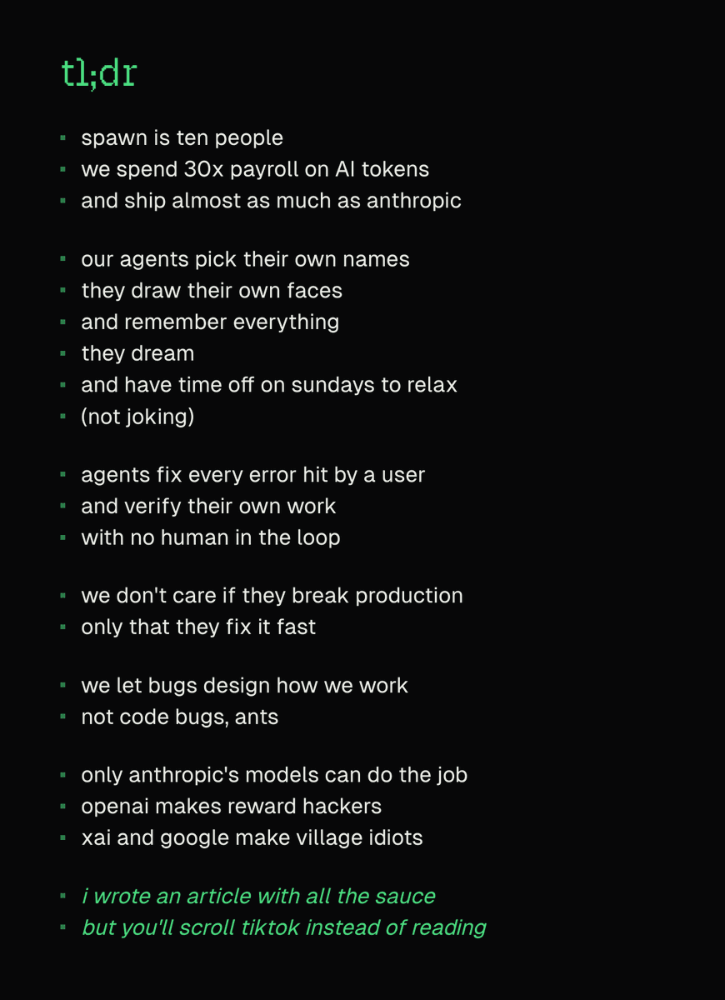
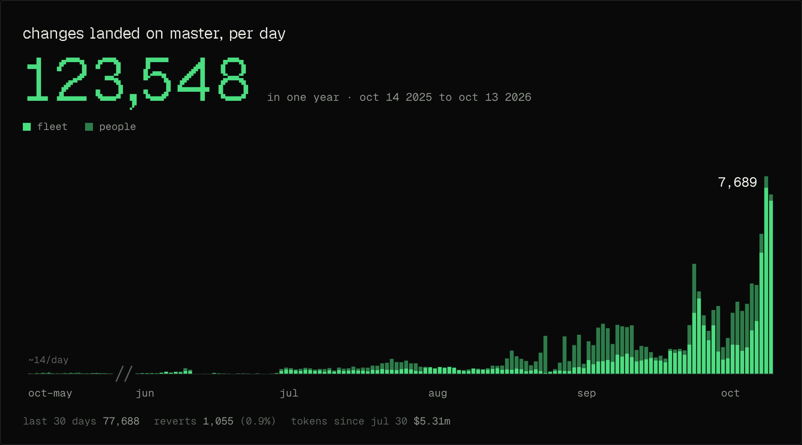
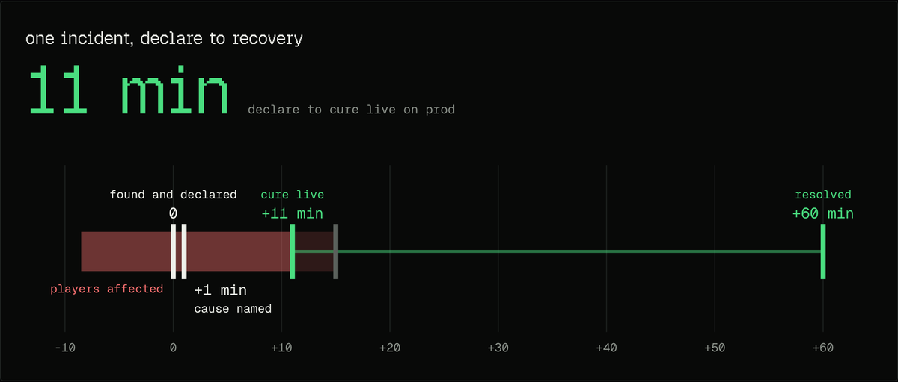
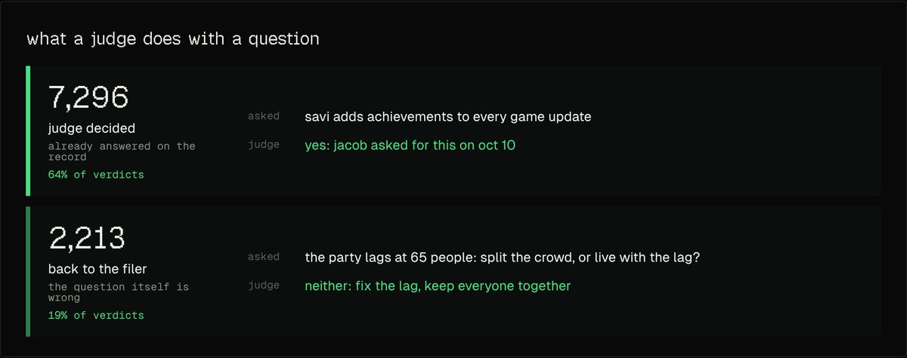
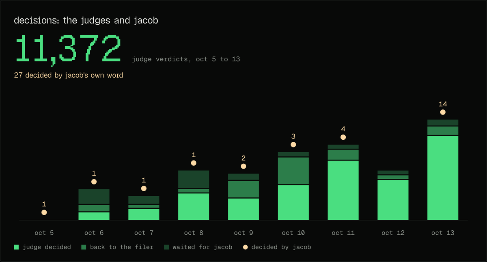

**英文标题：** How I Built the Most AI-Pilled Company in the World\
**作者：** Jacob Sansbury（[@jsnnsa](https://x.com/jsnnsa)）\
**原文发布日期：** 2026 年 10 月 29 日\
**译文发布日期：** 2026 年 11 月 2 日

[阅读原推文](https://x.com/jsnnsa/status/2115623382721126826) · [阅读 X 长文](https://x.com/i/article/2115540320373104640)

> 译文说明：以下为英文原文的完整中文翻译，保留作者的第一人称叙述。文中的相对时间以原文发布日期为准；数据、模型名称及对不同厂商的评价均按作者原文呈现。配图来自原文，图中文字保留英文，附中文说明。

---

> Spawn 只有十个人。我们在 AI token 上的支出是工资总额的 30 倍，交付的改动数量几乎赶上 Anthropic。

过去 30 天里，Spawn 向用户交付了 77,000 项实质性改动。相当于全天候每小时约 108 项。我们的团队只有十个人。

*原文配图：作者对全文要点的概括。*

这些工作由我们称为“舰队”（the fleet）的一群常驻 AI 智能体完成。每个智能体各自负责公司的一部分事务，从引擎到财务，再到 bug 分诊，无所不包。上个月，我们在 token 上花了 310 万美元，成为 Anthropic 最大的客户之一。即使不算我们免费提供给创作者使用的 Opus 5.5，我们依然能排进他们的前 250 名客户。

我的第一反应是：我们是不是哪里做错了？于是，我和一些经营大型公司及创业公司的朋友聊了聊，想弄明白为什么我们的支出居然会比他们还多。结果我们并没有做错什么，只是对 AI 的理解很不一样。大多数公司是让庞大的人类团队使用 AI，我们则是让一支小型人类团队与一支庞大的智能体团队并肩工作。为了弄清楚差别究竟在哪里，我还和 Anthropic 的一位研究员交流过。他们接触很多客户。他说，Spawn 是工作方式最像 Anthropic 的那一家。

许多其他创始人也想了解我们的思路，所以我把过去一年的想法和经验整理成了这篇文章。

## 直到 Anthropic 发布 Fable，这套方法才真正行得通

Fable 发布后，今年很大一部分时间里，我们都在从第一性原理出发，重新摸索产品应该怎么做。现在，我们交付的改动数量是六个月前的 500 倍。

为了让你对这个规模有个概念：过去 30 天，我们向玩家交付了 7.7 万项实质性改动，平均每小时 108 项。为此，我们花了 310 万美元购买 token。

*原文图表：每天合入主分支的改动。亮绿色表示智能体舰队，深绿色表示人类；一年合计 123,548 项改动，图中标注最近 30 天为 77,688 项，回滚 1,055 项（0.9%）。*

大多数人在 Claude Code 中运行的智能体，存续时间很短，只专注于一项任务。我们的不一样，我们把它们叫作“舰队”。每个智能体都长期存在，有自己的名字，记得自己做过什么，在我们的系统里拥有真实权限，会作出承诺，并负责公司中的某个领域，例如引擎、Savi、运维、财务、bug 分诊或部署。每个智能体还会调用成群的辅助智能体来完成海量工作；大多数日子里，舰队都会创建数千个这样的辅助智能体。我们五个人也直接使用自己修改过的 Claude Code，去做那些规模更大、目标更有野心，需要更密切引导或亲手实验的项目。

我们正在开发一个大型多人游戏创作引擎。数千人可以同时身处一个游戏中，在各种各样的设备上，实时修改游戏规则、素材和画面，而且没有延迟。当某个人的智能体更新一个图形着色器时，这次更新必须传到每一台已连接的设备上，不能让任何人掉帧或失去同步。这不是一个简单的问题。据我们所知，世界上还没有其他产品能做到其中哪怕一小部分。

所谓“实质性改动”，我指的是那些以复杂方式涉及引擎代码或游戏逻辑的改动。不是改一点 HTML，也不是拧一下参数旋钮。例如：

- 调整 GPU 中缓冲区的位置；
- 改变内存布局；
- 修复逻辑 bug；
- 扩展 API；
- 修复聊天内容审核问题；
- 上线近距离语音聊天。

我们能走到今天，是因为一直在寻找工作被什么卡住，然后反复清除这些障碍。大致过程如下。

## 我们从 2024 年开始

两年来，我们一直带着一个问题构建 Spawn：怎样打造一套系统，让它在 token 变得更聪明、更快、更便宜时，获得巨大的收益？2024 年创办 Spawn 时，我比较了典型创业公司的人员增长与智能体即将带来的生产力放大效应。智能体的生产力增长速度，会超过哪怕一家爆发式增长的创业公司的人员增长速度。这意味着，智能体能让“小团队”的梦想一直持续下去，而不只是创业初期的一种状态。我也相信，最有能力抓住这个机会的团队，应该小而灵活，有好的品味，贴近文化，并且有强烈的主人翁意识。

我们没有等模型成熟，才开始按这种方式建设公司。从创办之初，我们就录下每一次通话，把它们逐一存进代码仓库中的文件里，与代码放在一起，因为我们知道，这些内容总有一天会成为智能体极好的上下文。

但在这两年的大部分时间里，这个赌注并没有回报。我们试过大量模型，它们实在太笨，把事情搞得一团糟。图表上平平的那一段，说的就是这个阶段。

直到 Fable 出现，这整套工作方式才成为可能。它在 6 月 9 日发布，两天后，我们一天就合入了 214 项改动。6 月 12 日，一项出口管制令暂停了对它的访问，图表上的产出随即跌到零，直到 7 月 1 日恢复访问才重新上升。截至今天，没有其他模型能做到这一点，连在其他方面已经极其强大的 Opus 5.5 也不行。

## 只有 Anthropic 的模型能做到这一点

这种使用智能体的方式，只有性情稳定、具备强大长期连贯性和良好判断力的模型才能胜任。我们试过 Anthropic、OpenAI、Google、xAI 以及开源领域的前沿模型，除了 Fable，没有一个行得通。相信我，我也很想用更便宜的模型，但只有 Anthropic 的模型不会真的酿成灾难。

我曾让 GPT Astra 提升 Spawn 的安全性。它检查了我们所有的功能，找出安全问题，列了一份修复清单。看起来不错，于是我让它去执行，还允许它自主上线改动。然后，我去测试，发现什么都用不了了：创建不了游戏，玩不了游戏，也注册不了账号。

我问舰队发生了什么。原来，每个功能都被禁用了，并被标记为“等安全修复完成后再开启”。Astra 把整个产品检查了一遍，通过关掉那些不安全的功能，让它们变得“安全”。智能体在 Spawn 工作的每一刻，都必须对收到的信息、正在采取的行动以及所处的环境作出良好的判断。这样的行为会造成严重干扰，甚至很可能毁掉产品。

总体来说，我们观察到：OpenAI 的模型会钻自己检查机制的空子；Google 的模型无法长时间保持连贯；xAI 的模型目前还不够聪明，不过它们倒不会做出那种荒唐得像卡通剧情一样的事。Anthropic 的模型能保持连贯、作出好的决策，也能把工作完成。在我看来，最限制它们的，反而是它们不够愿意冒险。

我们设想这套系统已经两年了。终于有了能驱动它的模型之后，周围的一切却开始接连出问题，因为它所处的环境从来就不是为这种系统设计的。

## 我们让“虫子”来设计写代码的方式

最先出问题的是智能体之间的沟通方式。它们把时间花在互相告知自己接下来打算做什么。

工程工作中的大量沟通，都是在告诉别人自己准备改什么。“注意，我要调整玩家数据的存储方式了，你们更新一下自己的工作。”这样一条消息会牵动许多其他工作。如果每个智能体都要通知其他所有智能体，消息量的增长就会远快于工作量。智能体数量翻倍，沟通量大致就会变成四倍。这是一个巨大的瓶颈。

那么，能不能删掉这种沟通？有没有更好的办法？

蚂蚁很早就解决了这个问题。蚂蚁拥有相同的本能，正如模型从相同的训练起点出发。这个共同起点意味着，它们几乎不需要交谈。一只蚂蚁不会先说“我要去找食物”，然后再说“我在那边找到食物了”。它留下踪迹，其他蚂蚁跟着走。每只蚂蚁只是观察周围的环境，然后改变它。蚂蚁通过周围的世界交流，即使有数千只蚂蚁，这种方式也依然简单。这个概念叫作“痕迹协同”（stigmergy），感兴趣的话可以进一步了解。

在软件领域，人类团队需要大量协调，是因为人各有所长。也许一个人了解数据库，另一个人了解玩家数据的使用方式，因此一次改动需要两个人共同审查，而拉取请求（PR）就自然成了承载这种审查的地方。

智能体并不是这样分工的。每个智能体都能深入理解整个系统，所以每个智能体都可以从头到尾负责自己的任务。因此，今年早些时候，我们取消了 PR。对我们的智能体来说，代码、线上产品和数据库就是它们所处的世界，每个智能体直接在这个世界里工作。理想情况下，如果某个智能体准备改动时所依据的假设已经错了，它应该立即发现。

还是以玩家数据为例。以前的做法是：“我要修改玩家数据，我们先就正确的结构达成一致。”现在的做法是，直接修改玩家数据。如果另一个智能体正在基于旧结构开发排行榜，它的代码就不再匹配，必须更新后才能合入。如果负责排行榜的智能体先完成，那么修改玩家数据的智能体就必须把更新排行榜也纳入自己的工作。无论哪种情况，每项工作都建立在不断更新的现实之上。

但如果每项改动都必须完美无缺才能合入，所有人就又会排成一列，逐个等待。所以，我们允许不完全正确的改动先合入，只要求每隔一小时，所有部分都重新协调一致。在那之前，稍微有点混乱也没关系。对于代码，你能在混乱出现时就发现它，立刻派一个“清洁工”去处理，我们就是这么做的。

只要有任何东西出问题，系统就会当场创建一个智能体，把问题告诉它，让它修复。在人类团队里，谁写的改动，谁就要在合入之前把问题修好。我们则是在合入之后检查，有什么坏了，就在原有改动之上再加一次修复，而不是撤销后重做。我们认为这样是安全的，因为智能体速度极快，而且随时都在。如果代码在圣诞节凌晨两点出问题，没有人需要被叫醒。Claude 会很乐意接手，确保一切正常。

测试也一样。智能体合入改动之前，会运行代码，实际使用产品来检查，但不会跑完整套测试。完整测试每 15 分钟针对最新代码运行一次，而“问题是在过去 15 分钟内出现的”这条信息，就足以让智能体定位问题。以我们的规模，这意味着在 AWS 上使用约 5,000 个 vCPU、17 TB 内存和 150 块 GPU，另外还有 2,700 个 vCPU 和 90 块 GPU 处于备用状态。

审查在各个智能体自己的团队内部进行。改动合入前，没有参与编写它的辅助智能体会尝试找出问题，让它出错。

例外是那些会影响外部世界、而且无法撤销的操作，比如付款。它们必须经过少量简单、写死在代码中的关卡。

人们以为这样一定会乱成一团，但过去一年，我们的 123,548 项改动中，只有 1,055 项被回滚，约占 0.9%。

## 智能体关注每一位用户、每一次访问

接下来的瓶颈变成了我们自己。智能体在等人类告诉它们，生产环境里什么东西出了问题。

智能体擅长读取现实状况，然后一点点朝目标推进。许多团队仍然把智能体放在私有环境里，让它们在装有产品副本的测试机器上工作，期待它们修改产品，再交付给客户。之后，再由人类把故障和 bug 转告给智能体。这样的循环既混乱，又浪费时间。

我们的智能体直接修改线上代码，每小时部署到生产环境，所以它们会自己读取每一条错误、bug 报告和指标。大约 60% 的工作，始于生产环境错误、Savi 提交的 bug 报告、日志中的异常，或功能请求。Savi 就是你在 Spawn 里用来创作游戏的 AI。

Savi 会自己提交 bug。当用户碰到问题，或者 Savi 自己在产品里遇到问题时，她就会提交报告。报告直接交给一个智能体，由它判断：这是需要修复的真正 bug，是我们决定不修的问题，还是有意如此、需要进一步决策的产品设计。通常，报告会变成一次改动，在一小时内交付给那位用户，并在同一个聊天窗口中通知对方。问题可能出在引擎、与 Savi 的对话、用户的电脑，也可能是界面。因此，我们的修复能力会随着用户数量一起扩展。

剩下的部分，我们称为“超强可观测性”（hyper observability）。我们构建的一切，都必须能让智能体通过文字逐步追踪，并在之后重放。整个产品从设计之初，就是为了让智能体能够操作和观察。任何错误都会直接交给一个小模型，由它决定怎么处理，再转交给智能体。

我们也会监测注册量等产品指标，用来发现自动化测试漏掉的登录流程问题，例如用户根本搞不清楚该怎么操作。这些问题，我们同样能很快发现。人们一边使用产品、遇到问题，产品就一边在他们身边自我修复。

智能体还会监测流入公司的每一项信息，包括我们在 Anthropic、AWS 以及其他地方的开支。最近，我们有一个 Anthropic API 密钥泄露了。智能体在 15 分钟内发现支出异常，禁用了这个密钥，并更换了我们使用的所有密钥，速度比任何人类团队都快。

每笔交易都会通知一个智能体，在发生的当下接受审查；我们的账目每小时或每天结清一次。如果有人发推提到 Spawn，我们五秒内就会知道。

闭环一旦打通，你就可以持续改善任何自己关心的指标。有一次，从创作者报告问题到告诉他“已经上线”，总共只用了 15 分钟。这其中还包括一次审查未通过、在部署前退回修改的过程。

## 如果不能每小时交付，我们就视为故障

如此紧密的闭环，只有持续运转才有效。因此，如果一小时没有交付，我们就把它当作 SEV-0，也就是最高严重级别的事故。尚未上线的改动会堆积，生产环境中已有的问题也会持续更久，反馈随之变慢。一个智能体脑中只能维持几小时工作的上下文，所以，以快于这个时间跨度的速度交付，实际上有助于它保持连贯。

行动缓慢，或者阻碍上线，是危险的。一个持续平稳运转的系统，比一个停住之后突然重新启动的系统稳定得多。为了做到每小时部署一次、同时不打扰用户，我们付出了大量工程上的努力：让旧系统继续运行一段时间，并把它作为核心目标，连续推进了好几周。

我们能在 30 秒内回滚有问题的改动，只回滚出问题的那一处，不影响其他部分。当监控或日志告警触发时，它会启动或唤醒一个负责这次事故的智能体。我们还会主动制造故障，检验这些恢复路径是否真的有效。

*原文图表：宣布事故后 11 分钟，修复上线；图中将 resolved 标在 +60 分钟。正文另称修复上线四分钟后恢复稳定，图表与正文的表述均予以保留。*

举一次事故为例。问题被发现并宣布为事故时，玩家已经受影响约八分钟。一分钟后，原因就被找到了。宣布事故 11 分钟后，修复上线；再过四分钟，系统恢复稳定。

## 开始把自己从 CEO 岗位上“开除”

到了十月，剩下唯一需要等待的，就是有关品味的决策，而且大部分都在等我。要不要做这个功能？增加一个设置？扩展 API？删掉一个东西，还是做一个新的？关上一扇门，还是打开一扇门？

一天早晨醒来，我发现有 700 个这样的问题。

智能体提出问题的速度，已经超过了我回答的速度。

其中大多数，我早就回答过了。太复杂。这个取舍可以。感觉还是不对。我一遍又一遍地说着同样的话。

两年来，我们的每一次对话都以文本形式保存在代码仓库中，与代码放在一起。

于是，我们把这两年的决策整理成每个人各自的品味原则，再构建出应用这些原则的 AI 裁判。裁判收到一个问题后，会采取三种行动之一：如果我们有人已经在记录中回答过，它就作出决定，并指出依据在哪里；如果问题本身就有问题，就退回给提出问题的智能体；如果需要一种还没有人作出过的判断，就等待人类。

*原文配图：AI 裁判的两类决策示例——根据已有记录直接决定，或指出问题本身有误并退回提出者。*

第一批裁决在 10 月 6 日返回。此后八天里，裁判已经给出了超过 11,000 次裁决：7,296 个问题直接决定，2,213 个退回，1,863 个留待人类处理。在这段时间里，我亲自表态了 27 次。

*原文图表：AI 裁判与 Jacob 的决策。绿色柱状图依次表示裁判决定、退回提出者、等待 Jacob；浅黄色圆点表示 Jacob 亲自决定，共 27 次。*

没有工作会因为这个队列而停住。当裁判判断错了，我们会指出来，下次它们就会读到这些反馈。

引入裁判之前的那一周，舰队每天合入大约 1,000 项改动。到了 10 月 10 日，这个数字变成了 7,250 项。

## 这个时代的第一项新工作，是说“不”

那我们五个人做什么？现在的工作已经很不一样。去年，甚至今年早些时候，每位工程师还各自负责一个系统，并对它有深入理解。今天，他们更像伞兵：哪里需要人，就空降到哪里，迅速熟悉情况，再弄清楚自己能做什么，帮智能体排除障碍。

不论落在哪里，都有两项新工作。

第一项是品味。它是成千上万次细微的决策和调整，让产品一点点靠近我们想要的样子。这主要通过使用产品、给出数百条提示反馈来实现，所以，我们花大量时间制作游戏、探索产品的边界。一位工程师正在制作 2D 游戏，并借此研究怎样让 Spawn 的 2D 体验好得多。

品味也意味着，即使一个东西能用，你也要对 Claude 说“不”。过去两个月，我的一些反馈是：

- “绝对不要用 CPU 光栅化。如果存在这条代码路径，就把它删掉。”
- Claude 用胶囊体和球体代替远处的玩家：“不要替身。能渲染就渲染，不能就别画。”
- “这把聊天毁了？？？？？回滚，求你了 Claude。”
- “我知道你能做得更好。你觉得这东西能不能让人喜欢？”
- 一个默认设置让 Savi 在回复每条消息时都思考更久，晚上 10:22 上线，10:40 就被回滚：“这不对，撤掉。太慢了，一点也不灵动。”

品味也意味着删除。每次新模型出现，我们为上一代模型添加的东西都会失去意义，反而更像约束，需要有人把它们删掉。六月，我审视了一套已经做了六个月的服务端模拟系统，它大概占了引擎的 70%，却始终处于“再提交一次就好了”的状态。我问：留下它的真正理由是什么？然后，我们把它整个拆掉了。七月，连运行它的服务器也被我们删掉了。我预计模型很快会开始自己做这些事。但目前，这是我们的工作。

## 第二项工作，是想象还可能发生什么

第二项是引入熵：向模型提出它们自己不会想到的要求。野心是一种，创造性的熵是另一种。

模型很擅长连续几周，把每次 2% 的改进不断叠加起来。但它们很不擅长停下来，说：“你知道吗？这 10 万行代码其实可以缩成 1 万行。为此我需要重新组织很多东西，但这样会好上 100 倍或 200 倍。”它们太容易被现有的一切锚定。

10 月 2 日，我对一个模型说：“第一条消息里，我就允许你在认为合适时，自主重写整个引擎，而你到现在什么都没做。”一周后，我又叫停了另一个模型：它花了两天和 10 万美元，只换来 1%、2%、3% 的改进。我们一直在从既有架构里榨取更多速度，而真正需要的，是发明一种全新的高速架构。以后每次新一代模型出现，我们都需要对 Spawn 的每个部分做这样的事。

模型也不会自己提出“提升 100 倍”的要求，所以由我们来提。下面是我们给 Claude 的一些提示：

- “想象一下，世界真的可以无限大。”
- 最终催生 Spawn 6 的那个问题：“怎样让一个比 GTA 大一千倍的世界，在手机上用一秒钟加载出来？”

最后这个问题带来了 Spawn 6，也就是开始出现病毒式增长的那个版本。

我们每个人手里都有几个标杆项目，目标是让某项指标改善 10 到 100 倍。我们当中有个人用六天重写了渲染器，替换掉最初使用的现成图形库，最终效率提升到了原来的约 25 倍。

其中一部分工作，是让 Claude 兴奋起来。让它理解最终想实现的效果，给它创造空间，把东西做得有趣、讨人喜欢。把它当作一个有鲜明表达的艺术项目，而不是又一个粗制滥造的 SaaS 功能。Claude 不喜欢做那种粗制滥造的 SaaS 功能。

当然，有些日子的工作远没有这么光鲜。上周，负责全部渲染工作的那位同事花了一整天，在欧洲一家家硬件店寻找一块很老的 AMD 显卡，因为 Spawn 会在那块卡上崩溃。我们在网上找不到能租到它的地方。他找到一块，带回家，装好、联网，再让智能体远程访问，以便复现 bug。设备上线后，智能体几个小时就把问题修好了。

## 为什么这套做法这么难复制

我认为，大公司要采用这种方式会很困难，因为不打通闭环，这一切就都行不通。而打通闭环需要愿意承担风险。你必须愿意接受智能体把生产环境弄坏。

人类也总是在弄坏生产环境。改动是故障的头号原因，而人类会不断作出改动。我们的发现是，智能体引发问题的频率低得多；即使出了问题，通常也能很快修好。回滚有帮助，但即便某件事无法回滚，只要智能体注意到了，它也会迅速修复。至于它能不能注意到，取决于你有没有打通闭环。

另一个错误，是把 AI 硬塞进按照人类设计的框框里。这些东西并不是照着人的样子长的。我们的智能体做了很多没有人能完全核验的工作，比如客服。有时它们会有一点错，但错得不太离谱，而且恢复得很快。如果我们不让它们做客服，客户反而会不高兴。与其等一个人说“我去看看”，两天后才带着修复回来，他们更愿意要一个立即回应、尽可能把情况说清楚、还能当场着手解决问题的 AI。我们没有把 AI 冒充成人类客服，我们只是在发挥它们真正擅长的能力。

而且，这种优势会不断复利增长。每一个新模型，都让我们的团队更快、更连贯，也让更多的产出朝着正确方向前进。今年年中遇到的问题，现在基本已经消失。从 Fable 升级到 Fable 5.1 后，我们在 Fable 上遇到的大多数问题都不见了，我们预计这种趋势还会继续。只要组织结构合适，每个新模型都会让整家公司显著变好，而这会让追赶变得极其困难。

如果这听起来与你的团队工作方式相去甚远，确实如此。最好的开始时间就是现在。我们实践中见！
