杨宇辰（Whisper3080）主讲 · 62 分 57 秒 · 62 张视频画面。[B 站原视频](https://www.bilibili.com/video/BV1xSYxzDEPg)

按视频画面切分自动转录讲稿。个别术语和语句可能有听辨误差，可用每段的时间链接对照原视频。

## 跳到片段

- [21:39　竞赛训练阶段与前期目标](#slide-24)
- [25:04　刷题练什么、什么时候看题解](#slide-31)
- [32:10　多分支开题与题目池](#slide-37)
- [36:18　渗透学习法](#slide-40)
- [45:44　写自己的知识笔记](#slide-47)
- [53:06　中期训练与赛场策略](#slide-52)

[阅读杨宇辰与 FayeTY 的信奥训练方法对比](/content/oi-training-yang-vs-fayety/)

---

<h2 id="slide-01">01 · 00:00–00:12</h2>

[从 00:00 开始观看原视频](https://www.bilibili.com/video/BV1xSYxzDEPg/?t=0)

**讲稿**

> 大家好，今天给大家带来这个迟到了三年的信息学竞赛的主线攻略。这个视频制作花了16个小时，希望大家能够点赞投币支持一下。

---

<h2 id="slide-02">02 · 00:12–01:49</h2>

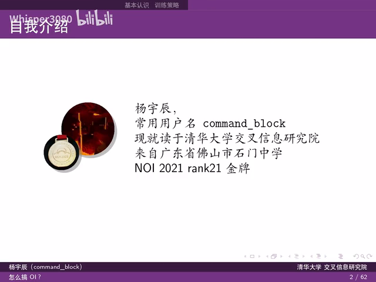

[从 00:12 开始观看原视频](https://www.bilibili.com/video/BV1xSYxzDEPg/?t=12)

**讲稿**

> 先介绍一下我自己，我是杨宇辰，现在就读于清华大学交叉信息研究院，高中是来自广东省佛山市石门中学。在21年的时候，在国赛拿到全国第21名，获得金牌。
>
> 然后这个大概是什么水平呢？拿乒乓球打个比方，就是比国家队弱点，比省队强点，也就是国家队陪练这个样子。
>
> 今天跟大家聊一下，我搞竞赛四五年一千多天吧，攒下来的一点心得。为了照顾各路听众，我们从很浅显的到非常细节，非常内行的东西都会讲到，希望大家能给我一点耐心。
>
> 首先介绍一下我的风格，我觉得我不是属于那种反应很快的选手。赛场发挥是我的短板，很多人脑子都比我好使，他们的竞技状态比我好很多。
>
> 临场反应特别快，特别好，我在这里不占优势。那我的长板是什么呢？
>
> 我觉得是我的训练规划，可以说在五年前那个年代，我自己从一无所知，打出了一个有效的体系，最后练到了还不错的水平。所以如果你在全中国当时挑四个最强的选手，我肯定选不上的。
>
> 我这个脑袋硬件不够用。但是如果你挑五十个最强的肯定有我，我退役之后一直有关注OI的动向，包括知识体系、资源和制度的演变。
>
> 现在我感觉这个资源是越来越好了，但是仍然有很多选手的天分是被浪费的。如果他们能像我一样采取一个合适的训练策略，我觉得我连他们的尾气都吃不到。
>
> 所以今天我把自己一点秘诀全都给各位交出来了，希望可以帮到大家。

---

<h2 id="slide-03">03 · 01:49–01:52</h2>

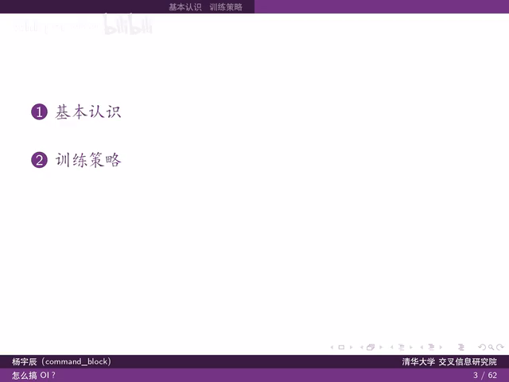

[从 01:49 开始观看原视频](https://www.bilibili.com/video/BV1xSYxzDEPg/?t=109)

**讲稿**

> 好了，闲话少说。我们来看第一部分关于竞赛的基本认识。

---

<h2 id="slide-04">04 · 01:52–02:49</h2>

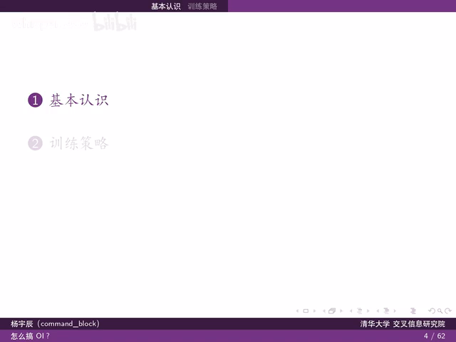

[从 01:52 开始观看原视频](https://www.bilibili.com/video/BV1xSYxzDEPg/?t=112)

**讲稿**

> 首先先说明一下，我主要介绍的是中学的信息学奥赛，也就是俗称的OI。如果你是大学生，你是打XCPC或者打〔赛事简称听不清〕的，那么这些训练方法应该也有一定的参考价值。
>
> 如果你是五大竞赛的其他科目，也就是数学、物理、化学和生物的也可以听一听。毕竟五大竞赛一家亲，您就当听个见识，听个乐呵。
>
> 然后大家普遍对高考的模式非常熟悉，所以我会重点比较竞赛和高考的不同之处，可能有人会说你搞竞赛的对高考不了解。那么我要说我也是考了高考的，因为我是高一退役的，我高一退役之后就回去上高中了。
>
> 然后我高三也学了，高考也考了，所以我在竞赛和高考都是打满全场的。俗话说没有调查，没有发言权，那么我基本是这几年最有调查的一拨人。

---

<h2 id="slide-05">05 · 02:49–05:17</h2>

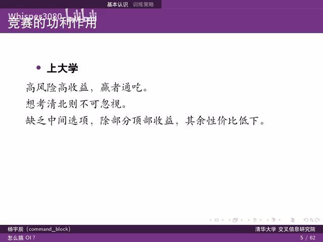

[从 02:49 开始观看原视频](https://www.bilibili.com/video/BV1xSYxzDEPg/?t=169)

**讲稿**

> 然后我们首先说的搞竞赛有什么用？搞竞赛最直接的目标就是上大学按照升学目标来讲，我们不解释具体政策的只说结论。
>
> 相比于高考竞赛，是一个高风险高收益的东西，或者说是一个赢者通吃的东西。先说高收益，就是在我的高中，今年跟竞赛有关的清北录取数量，也就是保送和银牌强基已经跟裸考的总数不相上下了。
>
> 然后在大学。清华姚班80%的学生有竞赛背景。
>
> 所以如果你想考清华、北大的话，这个竞赛是不可忽视的一条路。再说高风险，竞赛是没有中间选项的。
>
> 如果你高考的话，想考清北失手了，就考个华五，想考华五失手，考个中大，但是搞竞赛失手了，可能你就啥也没有了，很多时候就差那么一点点，它在升学上的作用，就从清北、华五变成零了。即使还有一点用性价比也非常低的。
>
> 也就是说，搞竞赛基本不存在，求其中这个选项也不存在求其上，得其中这个后路在考大学这一块，你的目标就只能是求其上得其上。如果没有这个胆量就不要来了。
>
> 第二点，从这个知识上来讲，竞赛的知识性价比是大于高考的。我搞高考的感想，就是说他们有太多精力浪费在熟练度上面。
>
> 高考数学在进入高分段之后，基本上就变成一种体育运动了。上了大学就发现高考主要起到选拔的作用，它的知识容量真的是不大。
>
> 在里面过于精雕细琢这些东西你上大学很快就忘掉的，但是搞竞赛你能学到点真东西，竞赛的知识尚不封顶，它不会在局促的知识框架里面过分内卷，别的竞赛我不敢说了，至少在信息学，你认真学个一两年，在算法这一块你可能已经超过了很多211本科教育的水平。在大学，很多人都在吃竞赛的老本。
>
> 但是吃高中吃高考的老本，我就闻所未闻了。所以如果你将来想要选计算机相关的专业，你想要从事相关的工作的话，那么OI虽然在升学上未必有直接作用，但是单纯在知识积累上对读大学也是很有帮助的。
>
> 就是说你负担不那么大的时候，你当时兴趣搞一搞也是挺好的。

---

<h2 id="slide-06">06 · 05:17–05:27</h2>

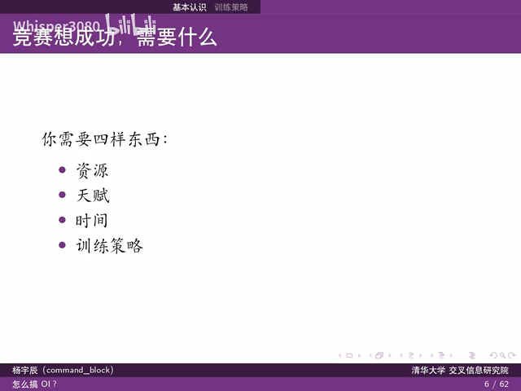

[从 05:17 开始观看原视频](https://www.bilibili.com/video/BV1xSYxzDEPg/?t=317)

**讲稿**

> 然后我们来说搞竞赛想要成功，大概需要四个要素资源，天赋 时间和训练策略。

---

<h2 id="slide-07">07 · 05:27–07:20</h2>

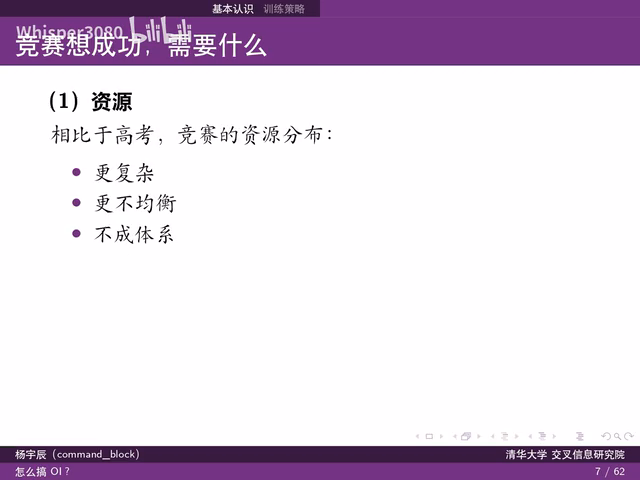

[从 05:27 开始观看原视频](https://www.bilibili.com/video/BV1xSYxzDEPg/?t=327)

**讲稿**

> 我们先来看资源，相比于高考竞赛的资源分布有这么三个特点。第一个是它分布更加复杂了，第二个是更加不均衡了。
>
> 第三个是这些资源是不成体系的。怎么叫更复杂呢？
>
> 就是这个资源它会来自于三个源头，分别是强校、机构和网络开源资料，三者可以说是哪一个都不可忽视，都非常重要。然后这一个三足鼎立的形式怎么形成的呢？
>
> 要给大家回顾一下竞赛的发展历程，就是这个信息学竞赛，它在五大竞赛中算是比较特殊的一个，它的发展太快了。也就是说，在过去20年里面，基本每过5到10年，这个竞赛题的难度就会翻倍，然后也不断有新的东西被引入到竞赛当中。
>
> 所以你会发现水平最强的竞赛者，基本上就是那些刚刚毕业的选手，这就导致这些最好的资源并不是什么老教师，什么专家所生产的，而基本都是刚刚毕业的选手，所生产的这么一个特质，一直以来影响了竞赛资源的分布。首先刚开始的时候，只有极少数发达地区的一些学校能有硬件搞这个竞赛，所以资源就只是堆积在强校里面。
>
> 那么随着竞赛越来越发达，越来越普及，高水平选手，那么他们就会组织到一些商业机构进入市场，那么就产生了机构。那么随着竞赛更加的发达以及互联网博客系统的这些发展，就是网络博客社区就变得越来越完善了。
>
> 这个网络开源资料成为了一个不可忽视的一个组成部分。然后最近十年的趋势就是这个开源资源，它真的占据越来越重要的地位。
>
> 从原来微不足道，变成现在已经占据半壁江山了。

---

<h2 id="slide-08">08 · 07:20–09:58</h2>

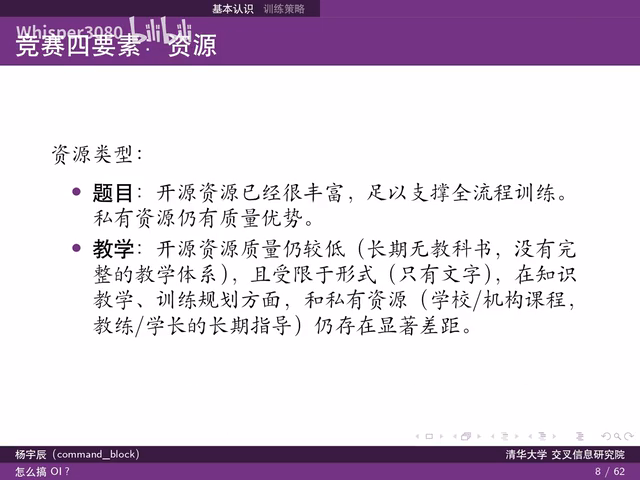

[从 07:20 开始观看原视频](https://www.bilibili.com/video/BV1xSYxzDEPg/?t=440)

**讲稿**

> 一下资源的类型，那么主要是分为两个部分，一个是题目，一个是教学。也就是说先把你教会教会之后，你就刷题非常简单，然后题目这一块非常好的消息是我们的开源的题目已经非常丰富了，就是这个跟文化课不一样。
>
> 你高考的话，想要刷题，一般是买一个教辅，或者说学校里的老师给你出一些卷子，很少有人说我们上网去搜题做的，但是搞信息竞赛，它的特点就是题目都在网上，就会有那种大型的题库网站叫OJ Online。Judge这些大型OJ经过数千年发展，他们的运营模式已经比较成熟了，然后也有非常多非常优秀的开源题目，资源存储在里面差不多在我那个年代，开源资源已经丰富到足以支持一个选手全流程训练了。
>
> 也就是说，你刷题完全不用碰任何私有资源，你也可以练得出来。那么现在资源肯定是更加丰富了，在我们当年发生了一个标志性事件。
>
> 就是在之前有一个OJ叫BZOJ，它是一个私有资源的代表，就是它攒了非常多的优质的题目，然后它去售卖权限号，相当于你付费刷题。当时一个权限号卖的还是很贵的，应该有几千到一万左右。
>
> 然后随着时代的发展，BZOJ的生意是越来越做不下去了。然后在我们那个年代，它最终倒闭了，这也是标志着开源题库的一个胜利。
>
> 然后但是目前还是有非常多的机构和学校持有丰富的私有题目资源，这些题目也是占有质量优势的。然后说到教学上面开源资源的质量仍然比较低。
>
> 我们这个学科非常特别，它是长期缺乏一个完善的教科书的。就比如说你读数学，你读生物，它可能会有一些教科书，可能来自大学或者来自于一些比较老牌的一些竞赛参考书。
>
> 但是信息学是根本没有这样一本书可以上下贯通的，也没有一个完善的教学体系。就连你先学什么后学什么也没有一个非常权威的一个指导。
>
> 我们的开源资源主要是什么呢？主要就是博客，它一般都是以知识点为组织的一些比较简短的东西。
>
> 受限于这个形式，因为只有文字，它缺乏交互性，所以在这个知识、教学和训练规划方面和私有资源，私有资源。比如说学校会给你讲课，机构也会给你讲课，以及教练和学长会给你长期的指导。
>
> 那么和私有资源仍然存在着显著差距，然后只有少数机构或者强校拥有比较完善的教育体系。

---

<h2 id="slide-09">09 · 09:58–10:39</h2>

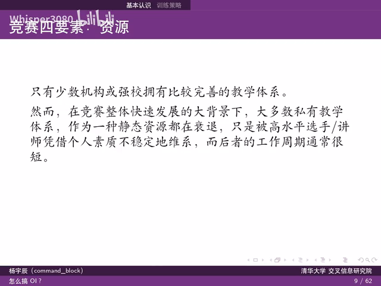

[从 09:58 开始观看原视频](https://www.bilibili.com/video/BV1xSYxzDEPg/?t=598)

**讲稿**

> 然而我们前面说了，因为竞赛是它目前还在一个快速发展的阶段。所以这种教学体系它都是不稳定的一种静态资源的话，那么他每时每刻都在衰退，往往来说，只不过是被这个强校和机构的一些高水平选手，或者讲是凭借个人素质来维系。
>
> 然而呢，后者一般都是高中生或者大学生，他们很快就会毕业。然后去从事其他工作了，所以他们的工作周期通常很短。
>
> 所以说强校或者机构单靠静态资源的老本是难以恒强的，最宝贵的资源仍然是高水平选手。然后说这个私有资源的地域分布。

---

<h2 id="slide-10">10 · 10:39–11:12</h2>

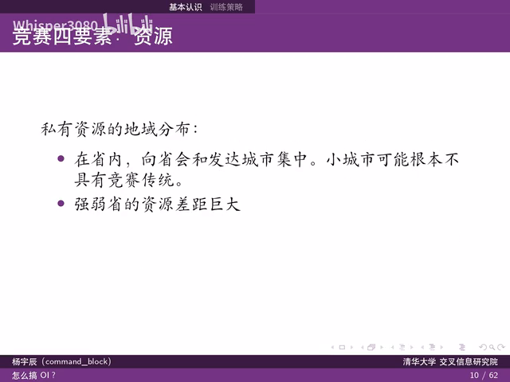

[从 10:39 开始观看原视频](https://www.bilibili.com/video/BV1xSYxzDEPg/?t=639)

**讲稿**

> 那么在省内一般会向省会和发达城市集中，这个小城市可能根本就不具有竞赛传统。你的学校，你的同学，你的老师可能根本没有听说过什么是竞赛，然后在省与省之间的差距也非常巨大，那么一个非常常见的现象。
>
> 就是如果你是一个弱省或者说一个小市的选手，那么你要么出省出市，然后依附于一个强校、机构。如果你留在本地的话，你基本上只能用到开源资源，结论资源，它不像文化课一样，你选择了学校，选择了教辅之后，它基本就是一个饭来张口的东西。

---

<h2 id="slide-11">11 · 11:12–11:38</h2>

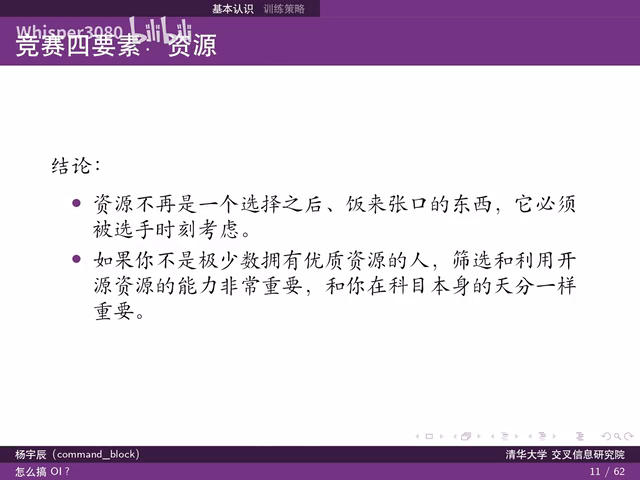

[从 11:12 开始观看原视频](https://www.bilibili.com/video/BV1xSYxzDEPg/?t=672)

**讲稿**

> 在搞竞赛的时候，你必须时时刻刻考虑到资源的因素。然后如果你不是极少数拥有优质资源的人，那么你必须去筛选和利用开源资源，那么在这一块能力是非常重要的，和你在科目本身的天分是一样重要的。
>
> 然后资源这一块讲完了，然后来讲讲天赋天赋，我觉得是挺玄学的，也有很多教练，很多家长都经常喜欢把天赋挂在嘴边，但是他们一般是结果论者，就是说你没有拿牌的时候，他们就不夸你，一旦有人拿牌了，就开始夸，就是说你天赋非常好，会非常怎么怎么样的。

---

<h2 id="slide-12">12 · 11:38–12:06</h2>

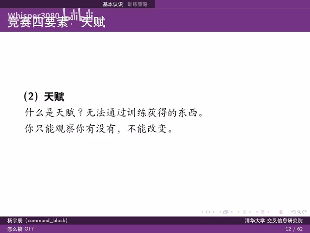

[从 11:38 开始观看原视频](https://www.bilibili.com/video/BV1xSYxzDEPg/?t=698)

**讲稿**

> 然后今天我来谈一谈我对天赋的理解。首先什么是天赋，天赋，就是你学不到的东西，你只能观察，你有没有你不能改。

---

<h2 id="slide-13">13 · 12:06–13:50</h2>

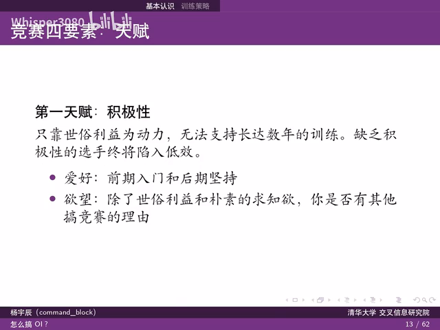

[从 12:06 开始观看原视频](https://www.bilibili.com/video/BV1xSYxzDEPg/?t=726)

**讲稿**

> 然后这个搞竞赛的第一天赋是什么呢？是积极性。
>
> 也就是说，如果你只靠世俗利益为动力，也就是说，你搞竞赛只是为了上个大学，那么你是无法在长达数年来训练，你坚持下来的。如果你这个选手缺乏积极性，那么你终将陷入这个低效的情况当中，那么积极性怎么提供呢？
>
> 第一个当然是爱好这个信息学，它要写代码，就其实很多人是很讨厌代码，他们觉得这个东西过于死板，然后这个逻辑又过于古怪。所以说你在刚学的时候，你看到这个代码这么冷冰冰的东西，你能够学进去，这已经挺有天赋了。
>
> 我感觉就是你前期入门是需要爱好的，还有这个后期坚持。因为竞赛的支持是上不封顶的。
>
> 你前期那些东西看着比较简单，看着比较符合人类的直觉。你到了后期这些东西就是要多复杂，有多复杂。
>
> 可能有人学到后期就越学越恶心了。那么你后期你还能有这种求知欲望，你能够面对那些复杂的东西，你能够学得下去，这也是一个天分。
>
> 然后还有欲望，就是说不同的人搞竞赛，有不同的理由，除了考大学和朴素的求职欲之外，可能还有其他理由。比如说我当年搞竞赛，因为我在不搞竞赛之前，就是一个比较无名小辈，然后我就不想是自己闷头闷脑的，过着一辈子。
>
> 我搞竞赛可能也就是有一部分是为了就整个响儿，就拿老话术或者说竞赛文化也形成了一个亚文化，可能对于某些人来说，竞赛也是他们的一个归宿。总之你得有一些比较健全的理由去搞竞赛，这样你才能走得比较远。

---

<h2 id="slide-14">14 · 13:50–15:30</h2>

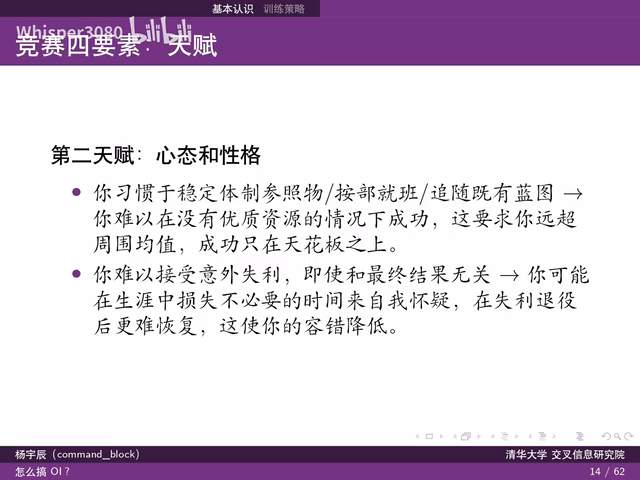

[从 13:50 开始观看原视频](https://www.bilibili.com/video/BV1xSYxzDEPg/?t=830)

**讲稿**

> 然后第二天赋，第二天赋是你的心态和性格。就是说如果你的心态和性格存在缺陷的话，那么它也会给你带来一些障碍。
>
> 比如说如果你习惯于一个稳定的体制，参照物，什么意思呢？就是文化课里特别常见，这种情况，你非常喜欢跟着年级的节奏走，然后你每一次考试，然后稳定进步多少名。
>
> 然后你一模二模之后，你再看你在省里面什么位置，然后你喜欢按部就班的跟什么一轮二轮复习，复习完之后，你就会达到一个固定的指标。像这样的习惯，这样的习惯就非常稳妥，非常适合文化课线性的学习。
>
> 但是搞竞赛的话，这样就是不行的。为什么呢？
>
> 因为基本上不存在这么一个很完善的周围的环境参照物。如果你不是那些强校的选手，你没有优质资源的话，你想要成功，你必须远远超过周围的君子，你必须超过周围人的想象成功，他只在千花板的上面。
>
> 所以说如果你想要藏身在周围的人中间的话，这基本是不可能成。然后第二点就是说有的选手他对自己的成绩过于敏感了。
>
> 也就是说比如他们去打一些网络赛，虽然这些网络赛是完全不影响他真实成绩的之后，他会非常怀疑自己，就是说竞赛这个随机性本来就是很大的。如果你的稳定性好的话，当然是一件好事。
>
> 如果你的稳定性差的话，也不需要太担心，毕竟你只需要赢了一次就行了。所以如果你心态比较敏感的话，你可能会浪费很多不必要的时间来自我怀疑。
>
> 然后在退役之后也更难恢复，这样就使得你的容错率降低了。

---

<h2 id="slide-15">15 · 15:30–17:14</h2>

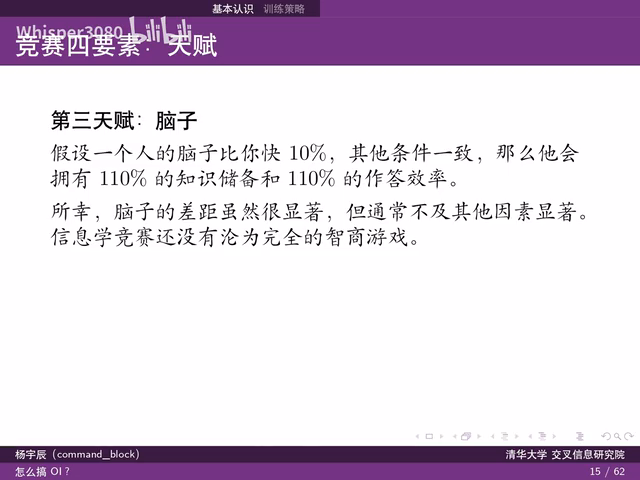

[从 15:30 开始观看原视频](https://www.bilibili.com/video/BV1xSYxzDEPg/?t=930)

**讲稿**

> 然后第三天赋才有脑子。就是说假设有一个人脑子比你快10%。
>
> 那么你会发现，然后考试也比你快。10%总的来说，它就比你快。
>
> 21%这个影响是平方级别的，索性脑子的差距虽然很显著，但是一般不如其他因素显著。也就是说，有脑子非常好使人他们卡在其他地方了，竞赛不需要你脑子非常好使才能搞它还没有完全沦为智商游戏。
>
> 我觉得这一点是非常好的，它还考察了你其他的素质，然后有这么一个现象，你搞竞赛真的是脑子不够用的话，那么你应该很早就退出了。所以在这个竞赛里面吃了大亏的人呢，往往就是他脑子很够用，但是他其他因素存在一些缺陷，就跟我们打得谱一样。
>
> 如果你的底牌很差的话，你就最多亏一个盲住。但如果你的底牌还不错，但是不够好的话，你可能就推了all in然后被别人收了。
>
> 所以就是说这个运气最差的人亏掉盲住运气。第二，好的人呢会亏掉全部。
>
> 所以我想说就是这个退出可耻了。德普里面有句话叫nice fold。
>
> 就是说你如果觉得自己真的是很难坚持下去，你跑路的话跑得好就是大赚很多人。其实他感觉自己不太搞得下去了，他为什么一直不甘心退出呢？
>
> 因为他觉得对自己没有一个交代，也就是在世俗的观点当中，大家都夸他脑子很聪明，很有天赋，将来一定会成功，结果他自己搞不下去，他就觉得非常失望了。其实就是脑子这个天分踩到第三天分，我就劝大家好好考虑一下，就给自己一个离开的理由。
>
> 然后还有一些常常被误认为天赋误认为无法获得。

---

<h2 id="slide-16">16 · 17:14–17:49</h2>

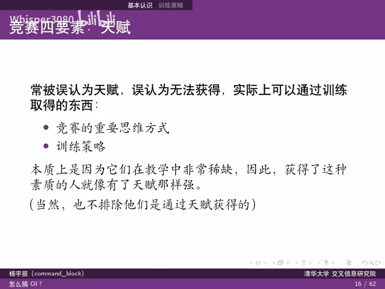

[从 17:14 开始观看原视频](https://www.bilibili.com/video/BV1xSYxzDEPg/?t=1034)

**讲稿**

> 实际上你练一练就可以练出来的东西，主要是两个，一个是竞赛的一些重要思维方式。就是说如果你没有这个思维方式，那么你在做某些题的时候，你是很难做出来。
>
> 然后还有一些就是训练策略，那么这两个东西本质上是因为他们在教学中非常稀缺。教这些东西。
>
> 因此，如果你获得了这些素质，那么你就像有了天赋那样强大。当然也有些人是无师自同，没人教他们自己就想出来了。
>
> 然后说到第三个要素，也就是时间常见的问题。

---

<h2 id="slide-17">17 · 17:49–18:10</h2>

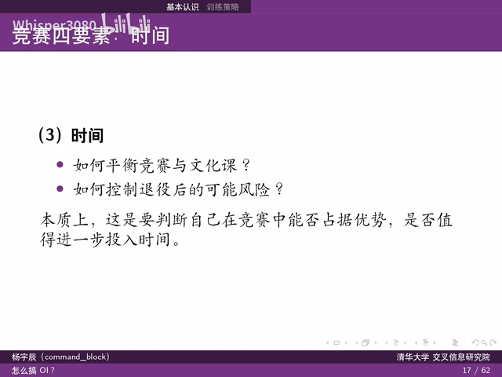

[从 17:49 开始观看原视频](https://www.bilibili.com/video/BV1xSYxzDEPg/?t=1069)

**讲稿**

> 如何平衡竞赛和文化课的学习，如何控制退役之后的可能风险。那么这个问题本质上来说，就是要让你判断你在竞赛当中到底有没有占据优势，是否值得进一步投入时间，你的水平有个底。
>
> 然后第二组问题，如何判断自己的时间是充足还是紧张呢？

---

<h2 id="slide-18">18 · 18:10–18:44</h2>

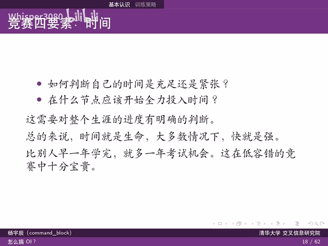

[从 18:10 开始观看原视频](https://www.bilibili.com/video/BV1xSYxzDEPg/?t=1090)

**讲稿**

> 在什么时间节点应该开始全力投入呢？这需要你对整个生涯的进度有着明确的判断。
>
> 然后总的来说越快越好，为啥呢？因为竞赛和高考不一样，高考不管你怎么学，你就只有那一次考试的机会。
>
> 但是竞赛你学得快，你是可以考两年的，而竞赛的本身的容错又比较低的话，这个机会非常宝贵。然后具体这个生涯进度，我们会在后面细细的分析。

---

<h2 id="slide-19">19 · 18:44–20:07</h2>

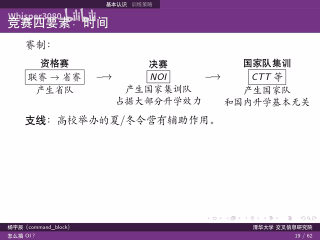

[从 18:44 开始观看原视频](https://www.bilibili.com/video/BV1xSYxzDEPg/?t=1124)

**讲稿**

> 然后我们来介绍一下这个竞赛的赛制，它大概可以由三个部分组成。第一部分是资格赛，就是从联赛到省选，它会产生一个省队。
>
> 然后第二部分是决赛，就是全国的所有省队会在一起考试。然后这个会产生国家集训队，是可以保送清华、北大的。
>
> 然后这个决赛在目前的情况下，基本占据了绝大部分的升学效力。然后考完决赛之后，你就可以参加国家队集训，那么这个就基本跟国内的升学没关系了。
>
> 所以我们说主线赛事是什么呢？就是资格赛到决赛这一条线叫主线，后面你可以看作一个副本。
>
> 然后还会有一些支线，就是高校举办一些夏令营和冬令营，那么会有一定的辅助作用。但是主要还是看这个决赛，然后主线的比赛是遍布上下学年的资格制。
>
> 所以如果你前面考烂了，那么后面就没资格了。然后对于一些比较强的省份呢，他们在资格赛的竞争强度是不弱于国赛的。
>
> 甚至你想进个省队，你想拿国赛的资格都已经比国赛银牌要难了。所以这就要求这个选手全年都要保持竞技状态，时间开销一定是非常巨大的。
>
> 所以竞赛不可能是副业，你不可能说我我一边搞高考，一边搞竞赛，说不定就成了呢。我告诉你，这不可能成，所以有人说这个学有余力再学竞赛。
>
> 你得保持人家的一边了。

---

<h2 id="slide-20">20 · 20:07–20:15</h2>

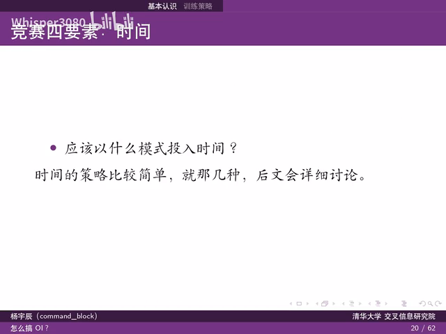

[从 20:07 开始观看原视频](https://www.bilibili.com/video/BV1xSYxzDEPg/?t=1207)

**讲稿**

> 然后最后一个问题，你应该以什么模式投入时间呢？那么时间的策略比较简单，就那么几种后文我们再说吧。

---

<h2 id="slide-21">21 · 20:15–20:54</h2>

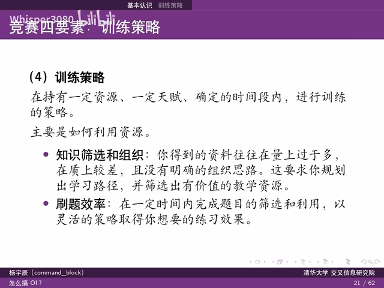

[从 20:15 开始观看原视频](https://www.bilibili.com/video/BV1xSYxzDEPg/?t=1215)

**讲稿**

> 然后第四个要素训练策略，也就是说你持有一定的资源，你具有一定天赋，而且你已经固定了训练时间段，那么你怎么进行训练呢？那么这个策略主要是如何利用资源，主要有两个问题。
>
> 第一个是知识筛选的组织往往在量上过于多，在智商比较差，而且没有明确的组织思路，这就要求你规划出一个学习路径，并且你要筛选出有价值的教育资源。第二个是刷齐效率，你需要在一定的时间内完成题目的筛选和利用，然后以灵活的策略取了你想要的练习效果。
>
> 训练策略之所以难是什么呢？

---

<h2 id="slide-22">22 · 20:54–21:31</h2>

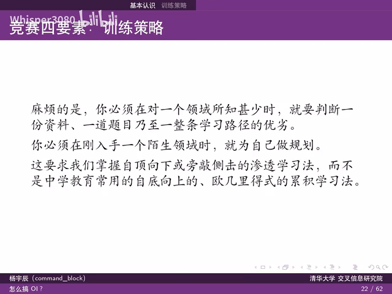

[从 20:54 开始观看原视频](https://www.bilibili.com/video/BV1xSYxzDEPg/?t=1254)

**讲稿**

> 是因为基本上没有人跟你带路。如果你要自己去做一个训练策略的话，你就必须在对一个领域所值甚少的时候。
>
> 一道题目乃至一整条学习路径的优劣。也就是说，你必须在刚入手一个陌生领域的时候，就给自己做规划，这就要求我们掌握这个自顶向下或者旁敲侧击的渗透学习法，而不是说这个中学教育常用的自底向上的欧几里得式的累积学习法。
>
> 也就是说它的思维方式是跟高考有非常大非常显著的区别的。

---

<h2 id="slide-23">23 · 21:31–21:39</h2>

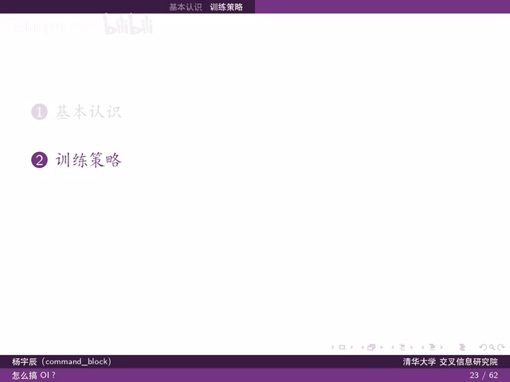

[从 21:31 开始观看原视频](https://www.bilibili.com/video/BV1xSYxzDEPg/?t=1291)

**讲稿**

> 然后一些基本情况，我们已经了解了训练策略，也就是攻略了重头戏。

---

<h2 id="slide-24">24 · 21:39–22:05</h2>

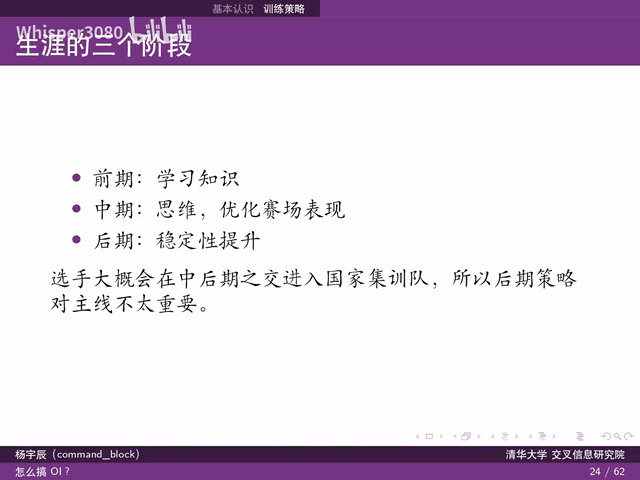

[从 21:39 开始观看原视频](https://www.bilibili.com/video/BV1xSYxzDEPg/?t=1299)

**讲稿**

> 首先我们将生涯分为三个阶段，前期就是以学习知识为主，而中期就是去锻炼你的思维，以及优化你的赛场表现。而后期基本上你已经摸到你的水平的巅峰了。
>
> 那么后期主要注重于稳定性提升。一个选手大概会在中后期之交就已经进入国家集训队了。
>
> 所以后期的策略对主线任务不太重要，我们就不讲。

---

<h2 id="slide-25">25 · 22:05–22:40</h2>

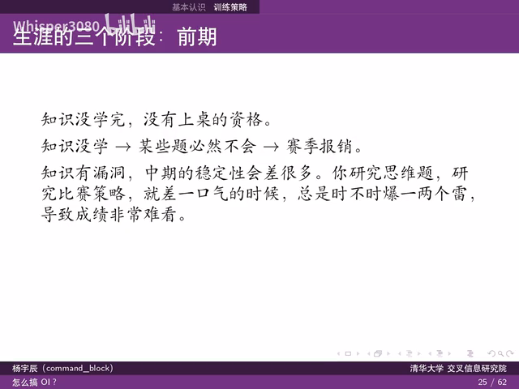

[从 22:05 开始观看原视频](https://www.bilibili.com/video/BV1xSYxzDEPg/?t=1325)

**讲稿**

> 那么来讲。前期首先第一句话，如果你的知识没学完，你就没有上桌的资格。
>
> 你知识没学某些题，你是必然不会的。你一旦挂了一个题，那么你整个赛季就爆销了。
>
> 如果你的知识学的有漏洞的话，那么中期的稳定性会差很多。当你在研究思维题研究比赛策略的时候，你就差那么一口气了。
>
> 然后你的知识那一块时不时爆，一两个雷，导致你的成绩非常难看。所以前期的主要任务就是只有一个尽量快，然后完成度，尽量高的学习竞赛的主干知识。
>
> 那么还会有些次要任务。

---

<h2 id="slide-26">26 · 22:40–22:56</h2>

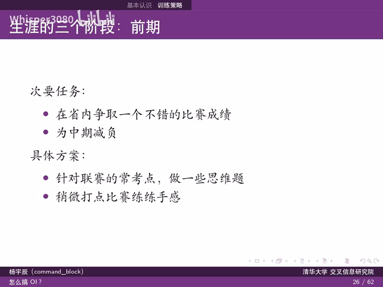

[从 22:40 开始观看原视频](https://www.bilibili.com/video/BV1xSYxzDEPg/?t=1360)

**讲稿**

> 比如说你可以顺便在省内争取一个不错的比赛成绩。然后你也可以为中期减减负具体方案。
>
> 就是第一你可以针对联赛常考的点刷一些思维题。第二，你可以稍微打打比赛练练手感，然后常见的误区。

---

<h2 id="slide-27">27 · 22:56–23:32</h2>

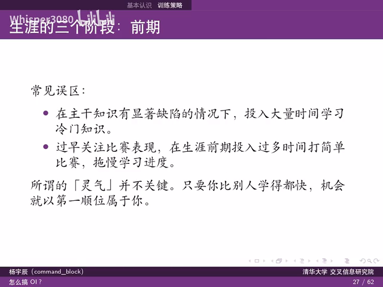

[从 22:56 开始观看原视频](https://www.bilibili.com/video/BV1xSYxzDEPg/?t=1376)

**讲稿**

> 第一就是在主干知识有显著缺陷的情况下，你投入大量时间学习冷门知识，就是说绝活哥。然后第二就是你过早的关注比赛表现，尤其是一些家长，他容易在早期就焦虑，然后就让选手反复去训练那些简单的比赛去优化。
>
> 那么一两个比赛表现这样拖慢了，学习进度就得不偿失了。然后所谓的灵气并不关键，也就是说你在比较弱的时候，你打比赛的那一点，灵机一动的发挥其实没什么用，只要你学的比别人都快，那么机会永远以第一顺位属于你。

---

<h2 id="slide-28">28 · 23:32–24:34</h2>

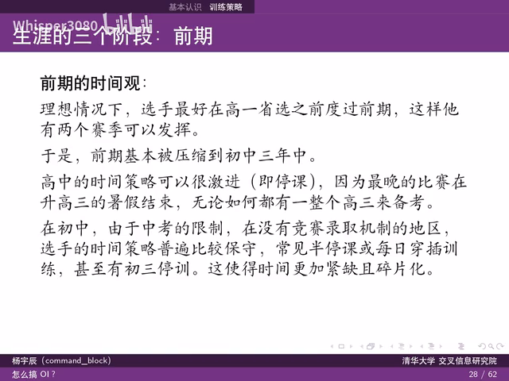

[从 23:32 开始观看原视频](https://www.bilibili.com/video/BV1xSYxzDEPg/?t=1412)

**讲稿**

> 然后前期的时间观念，在理想情况下，选手最好在高一省选之前度过前期，这样的话他就有两个赛季可以打了，也就是高一、高二，两个赛季他都可以打。然后现在普遍认为，一般来说，在初一开始学竞赛是比较好的，所以你前期基本上就被压缩到初中三年里面了。
>
> 然后高中的时间策略可以比较激进，也就是说停课为什么呢？因为最晚的比赛也就是第二次国赛是在升高三的暑假就结束了。
>
> 所以不管你考怎么样，那么你整个高三是可以拿来备考高考的。但是在初中由于考中考的限制，如果你这个地区没有竞赛录取机制的话，选手的时间策略普遍比较保守，那么一般是半停课，甚至是每日穿插训练，就可能每天只有一两个小时。
>
> 甚至于这个初三，他会不训练了，就专门搞文化课了。这就导致你初中的时间是非常紧缺，而且碎片化的。
>
> 所以还是那句老话，时间就是生命，然后在弱省和小市一个知识体系，健全的选手已经非常难得了。

---

<h2 id="slide-29">29 · 24:34–24:54</h2>

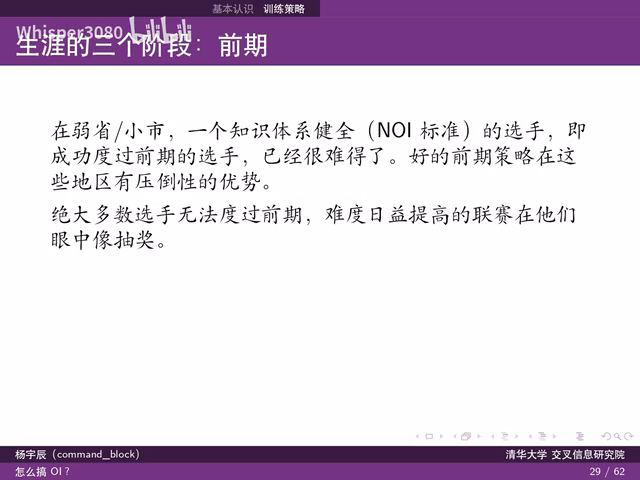

[从 24:34 开始观看原视频](https://www.bilibili.com/video/BV1xSYxzDEPg/?t=1474)

**讲稿**

> 所以说好的前期策略，在这些地区有压倒性的优势，绝大多数的选手都是没法度过前期的。那么前期的两大问题是什么呢？
>
> 第一是如何获取资源？第二是如何高效利用资源。
>
> 那么我们首先来说如何高效利用资源，那么就两件事，第一件事是题怎么刷？

---

<h2 id="slide-30">30 · 24:54–25:04</h2>

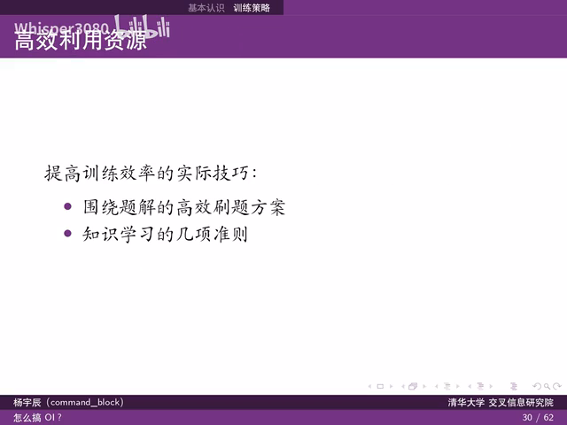

[从 24:54 开始观看原视频](https://www.bilibili.com/video/BV1xSYxzDEPg/?t=1494)

**讲稿**

> 第二件事是知识怎么学，先说题，怎么刷，为什么要刷题呢？

---

<h2 id="slide-31">31 · 25:04–26:09</h2>

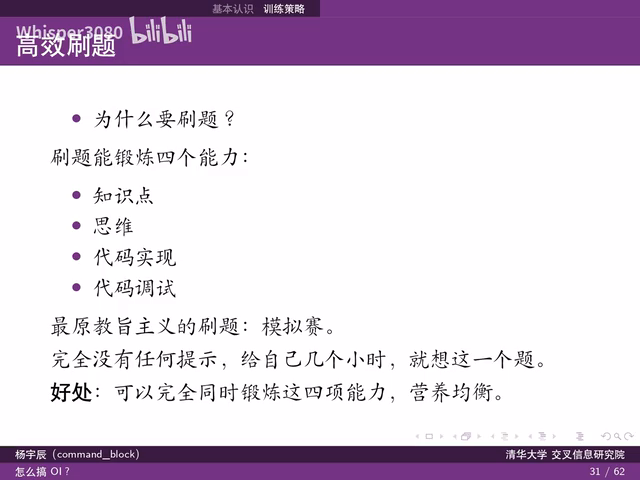

[从 25:04 开始观看原视频](https://www.bilibili.com/video/BV1xSYxzDEPg/?t=1504)

**讲稿**

> 刷题就为了锻炼你四项能力。第一个是知识点，就是说你怎么把这些知识运用到题目当中。
>
> 第二个是思维，就是你针对这个题目的具体情形，你需要进行一些推理。第三四个是代码实现和代码调试，就这个分类可能不是很严谨。
>
> 我更喜欢把它分成代码实现。就是说你需要学习一个算法最经典最主干的一个实现方式。
>
> 你自己的一个固有的格式，然后代码调试。也就是说，你在面临一些特殊的题目，它可能会产生一些变种，或者是一些拼接。
>
> 你需要在赛场上针对这个特殊情况去写出一些非套路的代码，以及往往要通过比较长时间的调试来达成最终的结果。好，那么说完了四个能力，下面说最最经典的训练方法就是模拟赛，就是说完全没有任何提示，就给自己几个小时，专门想一个题，好处是营养均衡，它可以同时锻炼这四个能力并没有什么缺漏，但是坏处就很多了。

---

<h2 id="slide-32">32 · 26:09–27:09</h2>

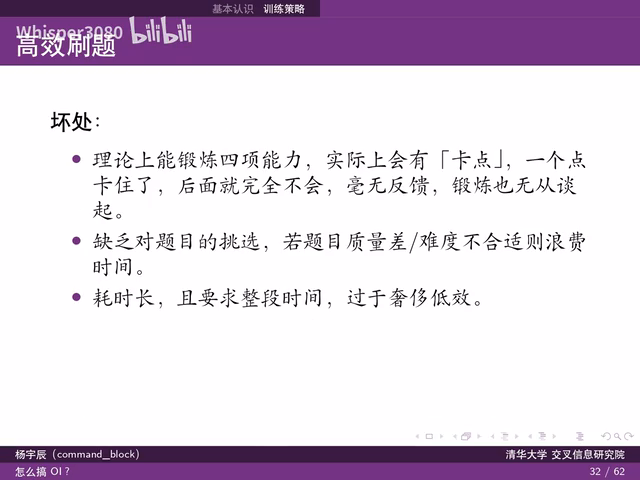

[从 26:09 开始观看原视频](https://www.bilibili.com/video/BV1xSYxzDEPg/?t=1569)

**讲稿**

> 第一，虽然理论上它可以锻炼这四项能力，但实际上会有卡点。也就是说，同一个体你可能在某一步不会了，你就做不下去了，导致你后面的环节你完全没有任何反馈，就没有任何训练效果。
>
> 所以说它的营养均衡是长期而言的。那么你在做一个体的时候，那么一丁点的锻炼。
>
> 然后第二，由于你是没有任何提示的，所以你是缺乏在题目的挑选的，你只能依赖于其他人或者是其他信息来源来帮你挑选题目。那么如果这个题目质量差或者难度不合适的话，就会浪费你的时间。
>
> 第三，它的耗时过于的长，而且要求整段时间过于的奢侈低效，可能有的选手他每天只有一个多小时来训练，连一个其实都想不明白。所以我们怎么改进呢？
>
> 我们要牺牲部分的锻炼效果来换取效率的提升。最后使得总收益能增大。

---

<h2 id="slide-33">33 · 27:09–27:35</h2>

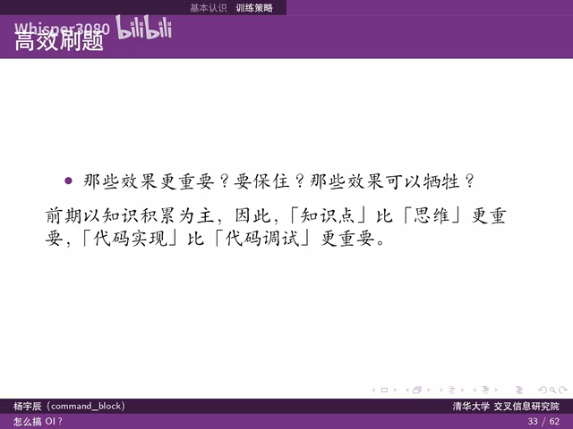

[从 27:09 开始观看原视频](https://www.bilibili.com/video/BV1xSYxzDEPg/?t=1629)

**讲稿**

> 那么我们就要思考哪些效果比较重要呢？哪些效果可以牺牲呢？
>
> 那么我们说了前期的一个最主要的任务就是知识积累。所以知识点是比思维更重要的代码，实现是比代码调试更重要的。
>
> 也就是说，我们先要关注那些不变的那些主干的那些套路的东西，以至于题目当中，那些千变万化的需要临场反应的比较具体的东西先放一放。那么就有第一种加速方案抛弃思维，就是我们完全放弃独立思考，我们就改一改这个刷题的目标，我们不是要独立的做出一道题，我们是找一堆优质的题解。

---

<h2 id="slide-34">34 · 27:35–29:26</h2>

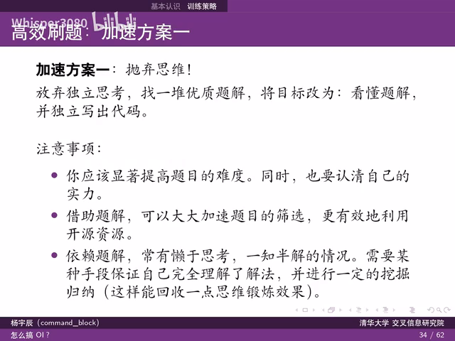

[从 27:35 开始观看原视频](https://www.bilibili.com/video/BV1xSYxzDEPg/?t=1655)

**讲稿**

> 我们的目标就是说我们要看懂这个题解，然后独立写出代码就可以了。那么会有三个注意事项。
>
> 第一个事项就是说你应该显著提高你刷题的难度，你原来没有提示刷2000份的题，你现在就应该刷2600甚至3000的题。如果你还是原地踏步去刷，原来那些简单题的话，效率固然是提高了，但是效果就差很多了。
>
> 同时呢你要认清自己的实力，认清自己是在题解的帮助下才能提高几百分的难度的。不要在比赛的时候，误以为自己已经能刷这些题了，然后没做出来就心态爆炸，对吧？
>
> 这就是属于不知道自己几云几两了。然后第二点是借助于题解，你可以去主动做这个题目的筛选。
>
> 也就是说。你不要先从题面观察它，你就第一眼就看它的题解。
>
> 这样子的话，这个题的主要知识点这个题的主要解法，这个题的难度如何，这个题的质量如何？以及这个题的简要提议如何，你都一目了然了，这样你自己主动摄影题目的话，效率非常高，可以有助于你更有效的利用开源资源。
>
> 第三个事项也是一个比较大的问题，就是说你依赖题解的话，常常出现你懒于思考意志半解的情况。就是说你看这个题解，即使这个题解有漏洞，或者它写的不详细，或者你根本没有理解它，你可能看着看着，只是看到最终的解决方案，你觉得很有道理，你就照做了。
>
> 所以你需要某些手段保证自己确实完全理解了这个解法，你确实能够独立的推导出这个解法，而且你还可以进行一定的挖掘。这样你还可以得到一些思维锻炼。

---

<h2 id="slide-35">35 · 29:26–31:18</h2>

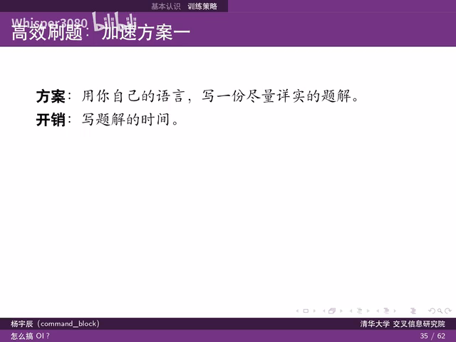

[从 29:26 开始观看原视频](https://www.bilibili.com/video/BV1xSYxzDEPg/?t=1766)

**讲稿**

> 那么这个怎么解决呢？你可以用你自己的语言，重新写一份尽量详实的题解。
>
> 这个方案的开销就是写题解的时间，对吧？但它是有非常多好处的。
>
> 第一个好处，只要你遵循了这个写作规范，你基本不会漏掉任何疑点。所以说只要你自己把题解写完了，你都这个题吃了就非常透了，你就完全消化了。
>
> 本题的减法。然后第二个它能更加有效的利用碎线化的时间。
>
> 什么意思呢？之前我们说了这个最朴素的方法，我们叫做干想吧，它做一个题是吧？
>
> 从想到写到调，他可能需要好几个小时。那么有些选手一天只有一个小时，你想你昨天想了一个小时，想了一直半解，想了一半，然后都写操考纸上了。
>
> 第二天你睡醒觉了，继续来训练，你发现昨天东西你看不懂了，那就完蛋了，现在情况也是一样的。即使你用了题解的帮助，因为你刷了题都变难了，而且也变大了。
>
> 可能你一天花一个小时，你还是看不懂这个题解。第二天回来继续看的时候，可能你昨天东西已经忘了差不多了。
>
> 它对碎片时间的利用是非常差劲的。而如果你有写自己的一个提解的话，你跟着你的思路写到一半。
>
> 第二天回来你要继续写因为你前面的东西都是你自己写的你基本上一目了然一眼就能跟上你原来的思路。对，然后第二点是它可以为未来的自己提供一个复习资料。
>
> 也就是说，相比于你去收集别人的提解，你自己的提解肯定是更加高跳的。你基本上看一两眼，你就知道当时我在想什么这个题有什么要点需要掌握。
>
> 而你如果要看一个别人的题节的话，你还要摸索半天，对吧？然后第四点也是比较重要的一点，就是它可以支持更灵活的开题策略。
>
> 这什么意思呢？我们细细道来，首先我们要说卡题，卡题，也就是说你花了很大精力去做一个题。

---

<h2 id="slide-36">36 · 31:18–32:10</h2>

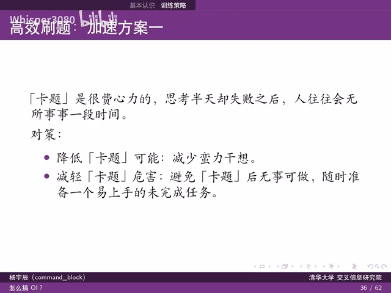

[从 31:18 开始观看原视频](https://www.bilibili.com/video/BV1xSYxzDEPg/?t=1878)

**讲稿**

> 但是由于这个题过于难，或者是你的一些知识储备还欠缺，你思考了半天，最终还是失败了。导致导致人摸鱼，就是说你想半天，然后结果发现自己一事无成的时候，你就会想摆烂，就会无所事事一段时间。
>
> 那么这对你的长期效率是非常差的，那么怎么减少卡题呢？第一，你要降低卡题的，可能就是说你不要搞那么多蛮力干想，对吧？
>
> 你没有体检，你就干啃的想，那么你想不出来概率是非常大的。第二，你要减轻卡题的危害，就是说你卡题之后就无事可做了。
>
> 所以你要随时准备一个容易上手的，还没有完成任务。一旦你卡题了，你就马上切换到这个任务上去。
>
> 那么怎么这样做呢？

---

<h2 id="slide-37">37 · 32:10–33:47</h2>

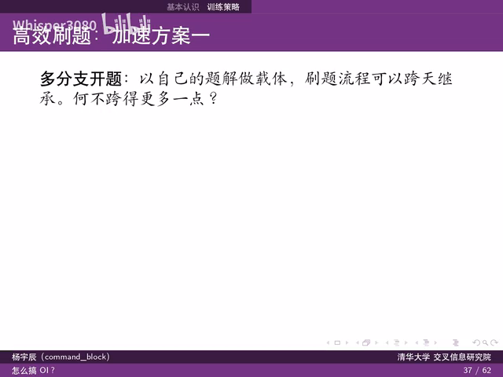

[从 32:10 开始观看原视频](https://www.bilibili.com/video/BV1xSYxzDEPg/?t=1930)

**讲稿**

> 就在介绍多分支开题。那么之前说了题解可以利用碎片时间怎么利用呢？
>
> 就是说以它作为载体，你可以把这个刷题游乘跨天继承。那么既然可以跨一天，为什么不多跨一点呢？
>
> 对吧？我们就可以这么搞，我们就可以维护三个题目池。
>
> 第一个池就是说一些叫好的题员，但是你没有筛选他们你没有亲自筛选，你只是听说他们比较好。B就是说你已经看过这些题了，他们确实很好，你打算做他们，但是你还没有看懂这个题解。
>
> C就是说你已经看懂这个题解了，而且写完了自己的题解，需要写代码。那么这三个池子就是说你在每个池子当中，你通过一些工作，你可以把它移到下一个池子，而且这三个池子都可以长期储存的对吧？
>
> 你写完了题解之后，其实你在那放放个几天，不太容易忘掉的。所以呢你就可以这么做，你有意的将任务并行。
>
> 然后呢，每个题你不要一口气把它做完，你可以先做一阶段，然后把它放到池子里面，然后在每个池子你维持一定的数量。如果你某任何一环卡住，比如说我看一个题的题解太难了，我看不懂。
>
> 那么这时我可以抽出一个没有写代码的题，我把代码写了，或者说我去挑选一些题目，这样子你就可以随时保持，有事干，就不容易浪费时间了。如果你一时保持线性流程，就说一个题开始做，就一定做完，先做完一个再做下一个。
>
> 这样的话，如果你卡了一个题，你就没有事可以干了这个多分支开题的策略。之所以有效是建立在这个写题解的基础建设之上的。

---

<h2 id="slide-38">38 · 33:47–34:20</h2>

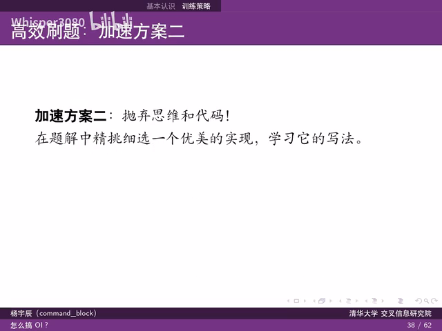

[从 33:47 开始观看原视频](https://www.bilibili.com/video/BV1xSYxzDEPg/?t=2027)

**讲稿**

> 好，下面我们来介绍这个更加激进的加速方案。二也就是说我们完全抛弃了这个思维和代码。
>
> 我们直接不仅要学这个题解的思维，我们还要学它的代码，实现挑一个写的最漂亮的人。我们直接学习他的写法，他优点就是效率极高，而且你能关注到这个优秀的实现方式。
>
> 缺点就是说除了这个支点和典型的代码实现，别的你一点都学不到，所以就比较容易营养不良，着不着背。

---

<h2 id="slide-39">39 · 34:20–36:18</h2>

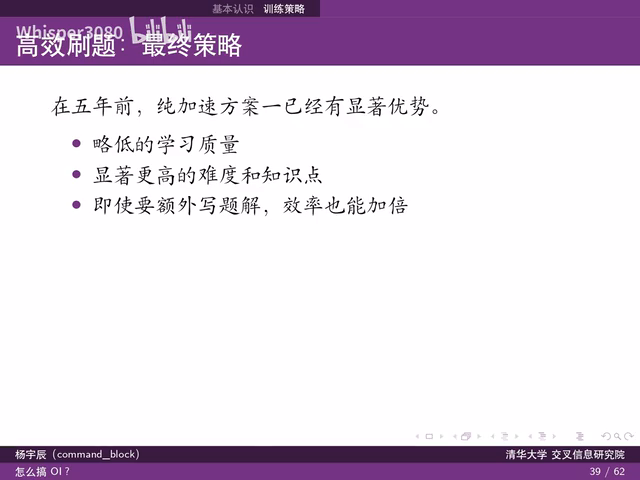

[从 34:20 开始观看原视频](https://www.bilibili.com/video/BV1xSYxzDEPg/?t=2060)

**讲稿**

> 然后总结一下，在五年前呢，就是我那个年代，你只是采用这个加速方案，一也就是看题解开题，那一定有显著的优势，不会降低你的学习质量，但是可以使你学习到显著更高的难度和知识点序列。即使你要额外写题解，那么效率也能加倍。
>
> 所以这是非常恐怖的。也就是说，如果有一个人采取这个策略，他不仅刷了题比你难，他刷了题还比你多一倍，那么你是基本是不可能有打过他的希望。
>
> 那么如今如果你要追求最好的效果，那么可以采用混合策略。那么肝想肝想是不可或缺的去干想的话，那么你的营养肯定是不均衡的，对吧？
>
> 但是你应该避免硬碰硬，就是国内的题它往往有一种堆料的趋势，就是说一个题它会堆积也非常多的考点，然后它代码实现也非常困难。那么如果你对这些题硬碰硬的话，效率就比较差，那么你就要挑选一些轻量级的，然后适宜连赛考点的题目去干想，比如说ARC就是很适合的。
>
> 然后重要的就是这个加速方案。那么我们推荐是一个方案，二，这种选一个为主，然后就一直用它两者都还可以。
>
> 那么方案二就是一个更加激进的方案，就是说它的中期风险会更大，但是它的效率会更快。什么情况下采用呢？
>
> 就比如说第一，你对自己的水平非常自信，你的时间也比较充裕。那么这时候你用方案二就速战速决，快速推过前期，甚至于你在初三就推过前期，这样的话，你的中期就非常的漫长，你甚至可以有三年的机会慢慢调整，或者是你的时间不足。
>
> 比如说你在初二或者初三才入了这个坑，你的时间不足了。你要在高一度过前期的话，你就被迫去采用这个风险稍微大一点的方案。
>
> 然后这个刷题方法就差不多讲到这。然后下面讲讲这个知识怎么学，就有一些关键问题。

---

<h2 id="slide-40">40 · 36:18–36:34</h2>

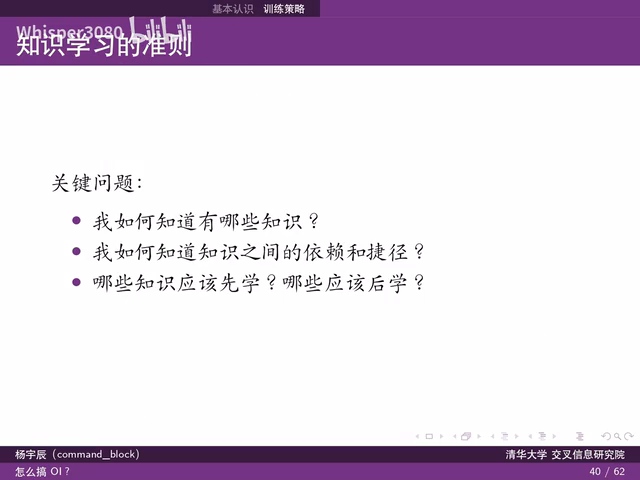

[从 36:18 开始观看原视频](https://www.bilibili.com/video/BV1xSYxzDEPg/?t=2178)

**讲稿**

> 第一是我怎么知道有哪些知识需要学呢？第二是我怎么知道这些知识之间的依赖和捷径呢？
>
> 第三，我应该如何规划？那么有一些非常重要的方法，第一就是渗透学习法。

---

<h2 id="slide-41">41 · 36:34–37:40</h2>

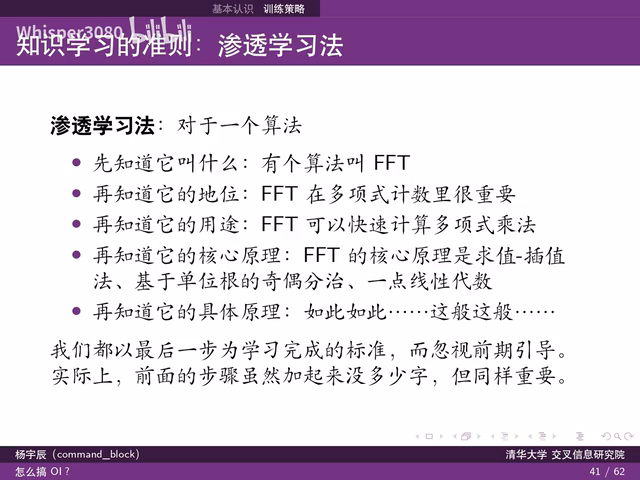

[从 36:34 开始观看原视频](https://www.bilibili.com/video/BV1xSYxzDEPg/?t=2194)

**讲稿**

> 对于一个算法，我们需要先知道它叫什么。比如说我知道有个算法叫FFT，别的还不知道。
>
> 第二个要知道它的地位，就是我听说这个FFT它在多项式计数里面非常重要，但是它具体干啥的，我也不知道。第三，我们要知道它的用途，这个FFT可以快速的计算，多项式乘法。
>
> 好，它的核心原理是求值—插值法，基于单位根的奇偶分治，再加一点线性代数。然后我们再学习它的具体原理，如此如此这般这般肯定要写个几千上万字。
>
> 然后我们实际学的时候，很多人都是以最后一步为学习完成的标准。但他们忽视了这个前期引导，甚至是看不起这个前期引导。
>
> 当有的人他对这个知识只知道一些基本信息的时候，他们就会说这些人是云玩家。但是我要说云玩家的美德这个云的能力是非常强的，这个前面的引导步骤虽然加起来没有多少字，但是同样是很重要的。

---

<h2 id="slide-42">42 · 37:40–39:59</h2>

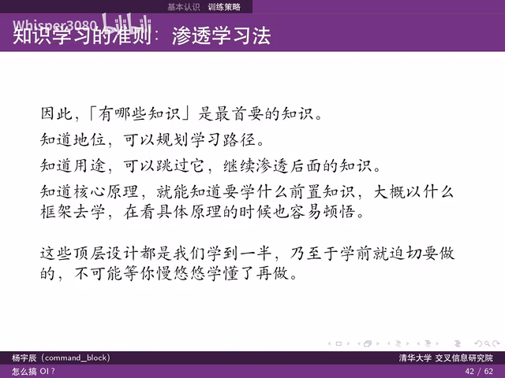

[从 37:40 开始观看原视频](https://www.bilibili.com/video/BV1xSYxzDEPg/?t=2260)

**讲稿**

> 所以呢有哪些知识是最首要的知识？这里我要给大家讲两个例子。
>
> 第一个例子是冬令营，就是说这个CCF会举办一个冬令营，然后呢，冬令营会有讲座，就会有一些选手来分享一些非常新的一些技术。那么这时这些技术他在一两个小时之内就会全部讲完。
>
> 所以在座的各位选手基本是听不懂的。但是大家开讲座之后，一看它的目录看完了目录，可以说这个讲座已经听完一半了。
>
> 也就是说，虽然你一点听不懂，但是看了目录之后，你就知道到底有什么东西，它的结构是什么样的，回去下来之后，你再学一学，基本都能学懂。然后第二件事就是这个OI Viki就是有这么一个网站，它大概容纳了这个OI里面大部分的知识，它给每个知识都写了一些介绍文档OI Wiki它存在一些缺点，但是它的目录已经是功德无量了。
>
> 就是说你甭管里面的东西写的怎么样，你光看它那个知识目录有哪些知识就已经非常有用了。好，然后接下去。
>
> 如果你知道这个知识的地位。就可以规划学习路径。
>
> 就是说我虽然不知道这个知识是什么，但是我知道它很重要，我是不是应该先学。第二，如果你知道它的用途，你就可以跳过它，提前渗透后面的知识。
>
> 比如说我知道这个FFT就是计算多项式乘法的，那么它里面是什么东西，我是不是可以不管了，我是不是可以快速去学后面的这些技术的内容了，对吧？然后第三，如果你知道核心原理，那么你就能知道很多东西了。
>
> 比如说我能知道要学什么前置知识，比如说FFT，我能知道我要学一些线性代数，我要学什么是复数，什么是单位根，对吧？以及我知道大概以什么框架去学，对吧？
>
> 你每一个核心原理大概是对应的一个部分，以及你在看具体原理的时候，你非常容易顿悟，就比起你完全no idea的人，你已经有一个大概了解的人，你非常容易顿悟，就你看着看着突然哦，原来这个就是什么什么什么，你一下就悟了，就效率提高非常大，这些东西都可以统称为这个顶层设计。这些顶层设计呢都是我们要学到一半，乃至于你学前就已经要做好的，不可能说等你学懂了再做，这是一个可能大多数人还没有get到的点。
>
> 然后说第二个方法。

---

<h2 id="slide-43">43 · 39:59–41:58</h2>

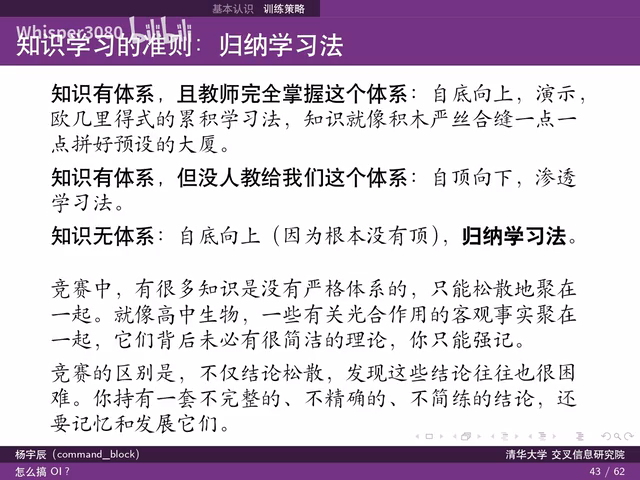

[从 39:59 开始观看原视频](https://www.bilibili.com/video/BV1xSYxzDEPg/?t=2399)

**讲稿**

> 也就是说这个知识它分为很多种情况。第一种情况就是说这个知识是有一个理论体系的，而且教师完全能掌握这个体系，高考基本都是这个情况。
>
> 那么学习就是一个自抵向上的过程，就是一个演示的过程，是一个欧几里得式的累积。学习法。
>
> 什么意思呢？就比如说欧几里得那个几何，原本就是第一条定理，第二条定理，然后两个定理合起来，又得到什么东西合起来，得到什么东西，慢慢拼拼拼，他把他最终的结论拼接出来，这个知识就像积木一样，一点一点拼好预设的大厦，那么如果这个知识是有一个体系的，但是没有人交给我们这个体系，那怎么办呢？
>
> 就是你拿到积木之后，你也不知道怎么拼，所以你需要自顶向下渗透式的学习，你需要先去大概的掌握这个体系的轮廓，然后再去研究具体的情况。那么还有一种更惨的情况，就是知识是没有体系的，不是所有知识都有一个简洁的理论，他们概括起来的，这时候你就只能自己向上学习了，因为根本没有顶，没有什么轮廓，这时候就要用到这个归纳学习法。
>
> 具体而言，比如说高中生物，比如说光合作用，那么关于光合作用有很多客观事实，就是生物书上那一页写了很多知识，那么他们只是松散的聚在一起，他们背后未必是有很简洁的理论的。你只能强行记下来，对吧？
>
> 那么竞赛它的区别是不仅它的结论，而且你连发现它们都很困难，对吧？你生物树上那些东西都老老实实洗在那了，而且概括的已经非常精辟，非常精确，非常正确了，你只需要背它们就完了。
>
> 而竞赛呢，你可能你的结论还要你一点点去发现你的结论可能是不完整的，可能是不准确的，也可能是不检练的。你不仅需要记忆它们，你还需要去发展它们，这样就给你带来了很大的挑战。

---

<h2 id="slide-44">44 · 41:58–43:47</h2>

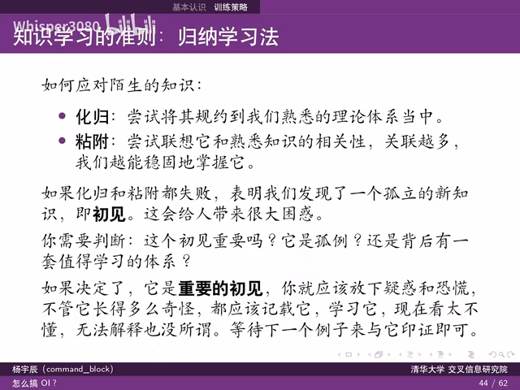

[从 41:58 开始观看原视频](https://www.bilibili.com/video/BV1xSYxzDEPg/?t=2518)

**讲稿**

> 那么如何应对陌生的知识建的有两种方案，第一种叫化归。也就是说这个知识虽然看起来陌生，但是实际上呢它可以完全纳入我们熟悉的一个理论体系当中，这样当然是最好的。
>
> 就是你对这个知识你没有任何的负担，它只是你的体系的一个推论。第二点就是粘附，也就是说这个知识它本身是没有什么理论可以解释的。
>
> 但是你可以尝试去联想联想它跟我们熟悉知识的一个相关性。那么这个关联越多的掌握它，这个学高中生物也是一样，就是你一个结论，你可以用其他派别的结论去给它互相印证，互相解释。
>
> 那么这些东西就会更加牢固了。但是有可能你的化归和粘附都失败了。
>
> 这时候就表明我们发现了一个孤立的新知识，也就是说初见这个时候人是非常困惑的，你需要干什么呢？你需要判断这个初见，它重不重要？
>
> 它是一个孤立，是一个非常特殊的一个孤独的例子，还是说它背后其实是有一套值得学习的东西。如果决定了它是一个重要的初见，那么你就应该放下疑惑，放下恐慌，不管它长得多么奇怪，不管它是非常不可你的品位，你都应该把它记载下来，学习一下。
>
> 即使你现在看不懂，你现在完全解释不了也没所谓，你只需要等待下一个例子来与它印证。也就是说，当他们这一个族群慢慢多起来之后。
>
> 把它收容起来，很多选手一直缺乏应对这个重要的出见的能力。他们就比较顾步自封，他们只能学习一些有体系的知识，他们一直在排斥一些他们陌生的知识团体，就导致他们的知识存在明显的缺陷。

---

<h2 id="slide-45">45 · 43:47–44:16</h2>

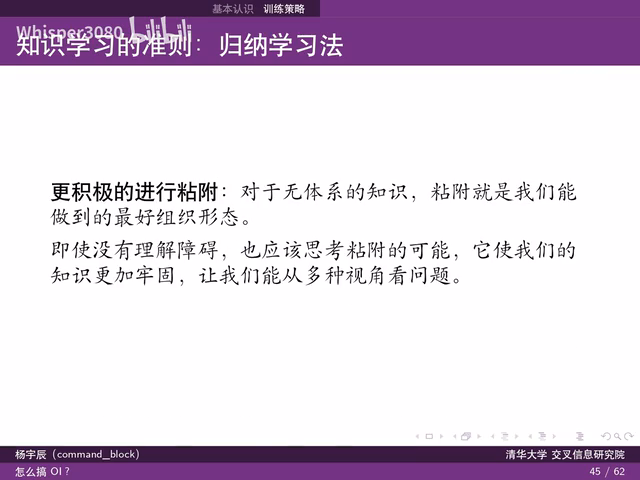

[从 43:47 开始观看原视频](https://www.bilibili.com/video/BV1xSYxzDEPg/?t=2627)

**讲稿**

> 然后呢我推荐我们更加积极的进行黏附。对于没有体系的知识，这个黏附就是我们能做到的最好组织形态了。
>
> 就你不用奢望能建立一个什么理论，但是你要多去捏一下，即使你对这个知识你没有理解障碍，你觉得它就算孤立存在，你也能搞懂它，你也尽量去捏一下，为什么呢？你捏的越多，你的知识就越牢固，而且能让你从多种视角看待问题，这个能力是非常宝贵的。

---

<h2 id="slide-46">46 · 44:16–45:44</h2>

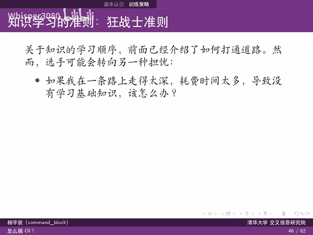

[从 44:16 开始观看原视频](https://www.bilibili.com/video/BV1xSYxzDEPg/?t=2656)

**讲稿**

> 好，怎么学习知识，怎么打通知识的学习道路，我们大概都已经说了，但是你可能会有另外一种担心。就是说如果我在某条路上走得太深了，花费的时间太多，制一些非常简单的非常基础的东西，我还没学，这怎么办呢？
>
> 那么这时就牢记一个准则，叫狂战士准则。如果你学一个知识学得很爽，学得很顺，不管这个知识名义上有多难，名义上有多后期你就接着学。
>
> 比如说你联赛还没有任何成绩，你学到一个国赛的知识，你发现你学得很爽，你一学就会，那你又可就是学学到学，不懂为止，不用担心说什么联赛不考之类的，为啥呢？两个原因。
>
> 第一个原因，你越级学习能够为你带来下一阶段的思考方式，而且能够显著增加你的复杂抗性。也就是说，联赛的知识通常都是比较简单的，没有那么复杂，那么你升学国家知识就是比较复杂的。
>
> 如果你能提前去学习那些复杂的知识，虽然在你考试里没有直接帮助，但是它能够使你的带宽增加了你能够承受更复杂的思考。然后第二个原因，一般情况下，你只要稍微越急，你很快就学不懂了，很快觉得很吃力了。
>
> 如果你没有觉得吃力，那说明你抽到宝了，这是一个男子的机会，赶紧学吧，别人想学，还学不到呢。好，这个是狂战士准则，然后还有一些零散的观点，比如说好记性不如烂笔头。

---

<h2 id="slide-47">47 · 45:44–47:49</h2>

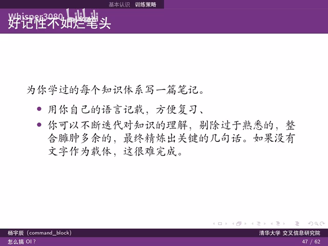

[从 45:44 开始观看原视频](https://www.bilibili.com/video/BV1xSYxzDEPg/?t=2744)

**讲稿**

> 前面我们说了，你去自己写一篇题字也是非常有益的。那么这里其实也是一样的，你学一个知识之后，你自己写一篇笔记也是非常有益的，有两点。
>
> 第一点当然是便于复习。也就是说如果你使用别人写的文献来复习，那么效率就会比较低。
>
> 如果是你自己亲手写的话，你基本一看就懂了。然后第二点比较重要的就是你可以借由这个文字作为载体不断的迭代。
>
> 你对知识的理解，这个我可以讲一下一个比较印象深刻的事，就是当年有一个竖竞和戏竞，双修的选手叫邓明扬。后来应该是拿了双料国际金非常强的一个选手。
>
> 然后他当年打完竖竞之后回来搞信径，他复健的时候就要复习自己做过的所有知识点。我记得他在UOJ发了一个博客，然后每天更新一下他的复习进度。
>
> 然后我一看他复习的实在太快了，他每天就能干掉十几个知识点。而且他每干掉一个，他就会写一两句话，总结一下他那个知识点是干嘛的。
>
> 我一看，我觉得这一两句话写得太精辟了，就感觉他写完之后就几十个字，感觉这个知识点已经讲完了，窝窜了。然而当时我刚刚学的时候，我写了好几千字来应付它。
>
> 所以你在对这个知识刚刚掌握的时候，你的理解是有冗余的，主词不分的。那么随着你熟练度越来越高，有一些东西在你的知识体系里面已经内化了，已经非常熟悉了，那么就可以把它剔除掉。
>
> 那么有一些东西是臃肿多余的，你也可以把它剔除掉。最后你就精练出关键的几句话，那么这个知识在你眼里就非常的熟了。
>
> 使你的基础稳固，还可以大大减轻你的记忆的负担。如果你没有自己的文字作为载体，你永远依赖于其他人的资料的话，你很难去完成这个迭代改进的这个事。
>
> 可能你刷题的时候，对这个知识有了一些新的心得，但是你没有记录下来，只是放在你的脑子里，那么很快就飘走了。那么最后再介绍一下如何利用开源知识。

---

<h2 id="slide-48">48 · 47:49–48:31</h2>

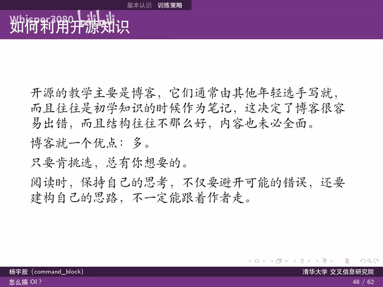

[从 47:49 开始观看原视频](https://www.bilibili.com/video/BV1xSYxzDEPg/?t=2869)

**讲稿**

> 那么开源的知识主要就是博客，这些博客呢主要是由其他年轻选手写的。而且往往是初学者的时候写了一个学习笔记，这就决定什么呢？
>
> 博客他往往很容易出错。而且他的结构往往不那么好，他内容也不一定全面，他的优点就一个就多，只要你肯挑选，基本上你就能挑到你想要的。
>
> 你阅读的时候需要怎么样呢？需要保持自己的思考，不仅你要辨别，可能会有出错，而且你需要主动去建构自己的理解思路这种，然后好怎么利用资源已经讲完了，然后下面来讲怎么获取资源，这个就简单讲一下。

---

<h2 id="slide-49">49 · 48:31–51:08</h2>

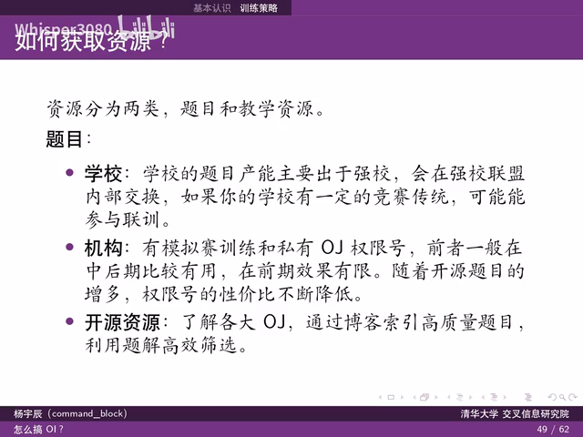

[从 48:31 开始观看原视频](https://www.bilibili.com/video/BV1xSYxzDEPg/?t=2911)

**讲稿**

> 然后前面说了，资源是分为两类的，包括这个题目和教学资源，那么题目主要就产自三方面。第一个是学校，那么题目的产能主要出自于强校。
>
> 那么这个强校他们会结成一些强校联盟，然后他们内部训练的时候会交换题目，互相做。不仅如此强的选手去做这些题目，然后最后会打成一个大榜。
>
> 如果你能去参加这些学校的联训，那么这个大榜还是有不错的参考价值的。然后第二个就是机构机构它一般会提供一些模拟赛训练，或者是一些私有OJ。
>
> 那么模拟赛训练呢一般在中后期比较有用，在前期效果有限。因为说了这个前期是以知识积累为主的，而且很多机构存在一个倾向，他们会把一些过于难的知识去倒着越级卖给一些前期的模拟赛。
>
> 比如说在联赛模拟赛里放过多这个省选和国赛的知识，这就导致学的人其实学不到什么东西。然后呢，后者就是随着这个开源题库的增多，这个权限号的性价比呢不断的在降低，现在应该已经很少机构采取这种方式来赚钱了。
>
> 然后开源资源，开源资源就是说你要了解各大OJ，包括国内的、国外的，比如说国内的名气比较大的有洛谷。然后UOJLibreOJ以及近些年新兴的有QOJ。
>
> 还有Hydro之类的，然后国外的有两个大头，比如说这个Codeforces（CF）还有AtCoder（ATC），还有一些稍微冷门一点的，比如说CodeChef之类的，这些你都要了解一下。然后第二点就是说这些题库的题是非常多，都有成千上万道，你刷一辈子也刷不完。
>
> 框定这个好题的范围。比如说你可以去找一些高水平选手去看他们的博客，他们平时可能有记题解的习惯。
>
> 那么你这个题解，连这个很强的选手都要专门记载一下。那么他可能质量不错吧，你就可以把它收集起来。
>
> 或者你在看一些一些教程的时候，他们往往会列出一些例题。那么这些例题也是很好的一个筛选的方法。
>
> 那么有了一个初步筛选之后呢，还需要你亲自去给这些题目，看看他们的质量。你开题就先开题解，利用这个题解，就能高效地筛选出你要做的题。
>
> 最后你整个生涯大概也就做个一两千题左右，其实就够用了。当然我这里说的是一个最低的数量，你想多做一点，当然也是可以。

---

<h2 id="slide-50">50 · 51:08–52:45</h2>

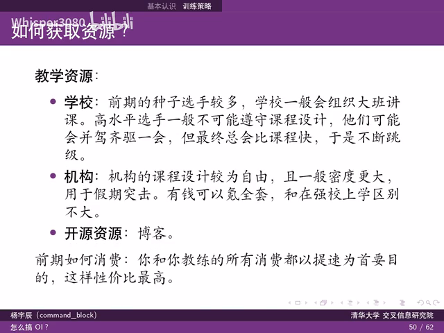

[从 51:08 开始观看原视频](https://www.bilibili.com/video/BV1xSYxzDEPg/?t=3068)

**讲稿**

> 然后教学资源首先是学校，那么前期在初中这个种子选手是非常多的。所以学校一般会组织一些大班的讲课。
>
> 但是高水平的选手一般不可能遵守他的课程设计。比如说像有一些强校，他会跟你说，你跟我的训练策略一二三四你就能成为牛逼选手了。
>
> 这个就是骗你玩的，真正的牛逼选手，不可能一二三四，真正的牛逼选手基本都是一三五八，这样走的就是他总是会比这个课程快一点。如果你一直并驾齐虚的话，在人堆子里面，你基本上搞不出来的。
>
> 然后第二点就是机构机构的课程设计是比较自由的，而且一般密度更大，适合于这个假期突击。然后听机构的讲座呢，你要秉持了这么一个信念，也就是说你在场你能听懂个两成，已经是欧弥陀佛了，剩下的回来再学，对，基本就是二八开，你现场听懂两成，回来学八成，它能够大大提升你回来学习的速度，就已经性价比很高了，然后如果你资金非常充足的话，你可以课全套，也就是有些机构会给你提供全套的解决方案，那么你在这些机构长期培训和在强校上学，一般区别也不大。
>
> 然后还有利用这个开源资源，博客没什么好说的，就直接搜就完了，以及关注一些质量比较高的选手。然后前期如何消费呢？
>
> 还是牢记那句话，你前期所有的消费都是以提高速度为首要目的。这样性价比最高，你不用太早的把钱都花在那些提高你竞技表现的东西，比如说摸你赛之类的，然后好讲了有半个多小时了，我们终于度过了前期了。

---

<h2 id="slide-51">51 · 52:45–53:06</h2>

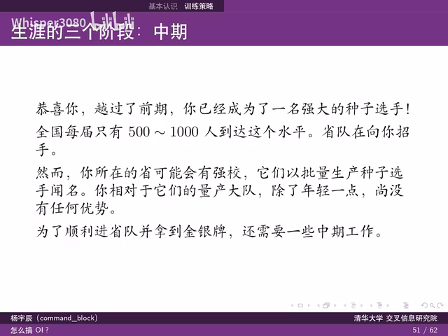

[从 52:45 开始观看原视频](https://www.bilibili.com/video/BV1xSYxzDEPg/?t=3165)

**讲稿**

> 恭喜你，你已经成为了一名强大的种子选手。全国每年每届基本上只有500到1000个人到达这个水平，所以省队已经在向你招手了。
>
> 然后为了顺利进入省队，并拿到金银牌，我们还需要做一些中期的工作。

---

<h2 id="slide-52">52 · 53:06–53:22</h2>

[从 53:06 开始观看原视频](https://www.bilibili.com/video/BV1xSYxzDEPg/?t=3186)

**讲稿**

> 那么中期的核心任务，第一个是增强你的赛场输出能力，包括思维和代码。第二个是熟悉比赛研究一下你自己的赛场策略。
>
> 第三个是你去收集那些不成体系的知识。

---

<h2 id="slide-53">53 · 53:22–55:08</h2>

[从 53:22 开始观看原视频](https://www.bilibili.com/video/BV1xSYxzDEPg/?t=3202)

**讲稿**

> 先说一下中期的时间观，进入中期之后，基本也进入高中了。选手一般都会在竞赛上使出全力。
>
> 这个停课是家常便饭和前期的碎片化训练不一样，全天停课，反而需要考虑时间过多的问题。中期的这个训练强度是大于前期的，因为前期是以学习为主，学习是比较轻松的。
>
> 其实我们高考的那个讲课的节奏是非常慢的。也就是说，白天老师讲课，下面的学生基本就当休息了，甚至还能顺便写写作业。
>
> 然后晚上晚自习可能才是比较耗费精力的一个阶段。但是这个中期基本上每天都在刷题，而且是一个强度训练。
>
> 我们希望通过刷题能够提高在赛场上的带宽。所以你要求中期选手一天12个小时，满强度训练是不可能的。
>
> 就好比你一天考试考到晚考12个小时，肯定是考死人的，所以摸鱼是必然的。就很多教练家长和选手，他们在制定中期策略的时候，不承认摸鱼的存在就导致什么呢？
>
> 第一，他们缺乏在摸鱼之后恢复的应对方案。第二，他们对时间的要求过于严格，导致选手的压力，白白增大。
>
> 最后的实际情况往往也是选手阳凤英伟偷偷摸鱼。所以什么呢？
>
> 大家要正视这个摸鱼的现象，就是在中期停课摸鱼是一个非常健康的行为，不利于健康的。与此同时，你需要有一个快速的恢复方案。
>
> 在你稍微摸鱼恢复精力之后，你要能快速的回到正轨上来，所以这个多开策略也仍然很重要。你要保留一个容易上手的，没有完成任务，它能够帮助你从摸鱼中快速的恢复回来。

---

<h2 id="slide-54">54 · 55:08–55:54</h2>

[从 55:08 开始观看原视频](https://www.bilibili.com/video/BV1xSYxzDEPg/?t=3308)

**讲稿**

> 然后好我们来讲，具体事项中期的一个主旋律，就是赛场带宽的提升。那么首先是代码能力，代码能力可以分为三个部分，主要是知识积累，我们能练的主要是第三个。
>
> 也就是说，马力你的目标是能达到能完全熟练秒题的水平。就是一个刚刚出前期的选手，他可能是非常不熟练的。
>
> 面对一个题，他可能心里没有底，他可能慢慢吞吞的写他一个小时写完了之后还不一定对，然后还调一调，可能在一个小时到三个小时之间才能搞定。那么对于一个中期的熟练的选手，他可能非常有自信，他可能半个小时，他90%就能把这个题搞定。
>
> 它们的容错就差距非常大了。那么怎么达到这个效果呢？

---

<h2 id="slide-55">55 · 55:54–57:28</h2>

[从 55:54 开始观看原视频](https://www.bilibili.com/video/BV1xSYxzDEPg/?t=3354)

**讲稿**

> 首先你得体验这种水平，那么有一个常用的方法就是分离法。就你要先把所有其他音响因素分开，就你做一个题，你是不稳定的，可能这个题的思路会卡，你这个题的一些实现方案会卡。
>
> 你比如说有些细节，我一直没想清楚，写着写着发现我漏了一个东西，对吧？这些因素你都把它完全排除掉，你纯纯锻炼你的代码能力。
>
> 这样在单个维度上，你很容易就能触摸到你的理想水平。这个策略在高考数学也是非常有用的。
>
> 就是之前都说这个高考数学，你的计算失误会丢很多分，但是到底计算有多重要呢？我当年就是选了一些填空题，然后把它们都做一遍。
>
> 做完一遍之后呢，我对这个思路已经记得非常熟了。然后我再做第二遍，就是说我完全抛开这个思路和知识点的负担，我就纯算。
>
> 如果你发现你纯算都能算错，或者是你纯算算的也不够快。那么你就知道这个计算的问题到底有多大了，或者是你通过纯算，你触摸到了自己的一个上界，你就可以去继续去追这个非常熟练的这么一种感觉。
>
> 如果你一直受到多重因素的同时撤走的话，你是很难找准这种感觉要扯远了。然后如果你基本练成了这个代码能力，那么你就会有相应的时间概念。
>
> 你写一个暴力，要几分钟呢？写一个拍子要几分钟，写一个部分分要几分钟，写一个正解要几分钟，你基本都心里有数。
>
> 这样子的话，当你执行你的比赛策略的时候，你就非常心里有底。

---

<h2 id="slide-56">56 · 57:28–59:11</h2>

[从 57:28 开始观看原视频](https://www.bilibili.com/video/BV1xSYxzDEPg/?t=3448)

**讲稿**

> 然后代码能力讲完了，下一个是思维能力，就什么是思维的带宽呢？第一点，对于难题你可以承载一个非常复杂的思维链，而不出错，就是新手他可能只会一步就一个题，他只会做一步。
>
> 一旦这个题有三四步，他可能做着做着就当机了，脑子就不够实了。第二个是对于简单题，你不会去降制，不会浪费时间。
>
> 比如这个简单题，其实你稍微一想就能秒了。结果你跟空气斗智斗勇浪费了一个小时，或者是你想了一些细节，你总是想不清楚浪费了一个小时，这个怎么搞呢？
>
> 首先你需要去刷复杂的思维体，如果你一到复杂体也没见过，那肯定是不行的。然后这时候你也可以挂上加速策略来刷。
>
> 然后第二个是对于你的稳定性。你可以去打网络赛，它相比于我们传统的中国式的模拟赛，它是有优点的。
>
> 因为网络赛它是时间短，题目多，它涉及的关键抉择，更多，更能够考谈起的稳定性。国内的模拟赛可能是五个小时三题，即使你默默唧唧在某个题浪费了一些时间，你也看不出来。
>
> 但是网络赛节奏非常快，比如说是两个小时六题，那么你一旦有一个题出现了失误就非常明显，你可以快速地跟踪自己到底有什么问题，训练负担还不会太重。还有一些其他有趣的方案，比如说你可以找一个思路非常复杂的题目。
>
> 然后你在理解了这个题目解法之后，你再把题解能默写出来。第二个是低分随机挑战。
>
> 也就是说你在稍微简单题里面随机取一些阳间题，然后试试能不能秒他们你秒多了之后，手感就会上来。

---

<h2 id="slide-57">57 · 59:11–59:16</h2>

[从 59:11 开始观看原视频](https://www.bilibili.com/video/BV1xSYxzDEPg/?t=3551)

**讲稿**

> 对，总的来说，中期就是注重于提升选手带宽。

---

<h2 id="slide-58">58 · 59:16–60:00</h2>

[从 59:16 开始观看原视频](https://www.bilibili.com/video/BV1xSYxzDEPg/?t=3556)

**讲稿**

> 然后说到比赛策略，比赛策略其实没有那么多花里胡哨的东西。男主要是男在你怎么信任他并且准确的实施他。
>
> 所以第一步是你要先把自己弄得比较稳定，你的带宽要比较的强。然后你去打模拟赛，去真刀真枪的尝试，不同的策略，这个得分自然会告诉你性价比的在这么一个阶段，有几种常见的情况，就有一些选手会千里迢迢来到一个强校，跟他们一起进行日常的模拟赛训练。
>
> 机构会提供一些模拟赛恩联测这些高强度测试可能会持续数月之久，甚至有一些长期熬在中期的选手，他们可能一两年都在做这种测试。然后还有一点就是你需要收集不成体系的知识。

---

<h2 id="slide-59">59 · 60:00–60:58</h2>

[从 60:00 开始观看原视频](https://www.bilibili.com/video/BV1xSYxzDEPg/?t=3600)

**讲稿**

> 前面我们说了，有一些知识是不能形成理论体系的，而是只能形成一些模糊的理念。在前期呢，我主要推荐大家学一些性价比高的知识。
>
> 也就是说这些知识它是可以形成理论体系的。在前期你过早的去研究这些比较混乱的东西，性价比是不高的。
>
> 那么到了中期，你的知识体系比较完整了，你的底力你的带宽也比较好了。那么这时候就是收拾他们的时候。
>
> 比较典型的这个类别，就是组合问题，就又称人类智慧。然后这个没有什么技巧，就是刷，然后跟前面说这些粘附的方法用就完了一个比较值得说的。
>
> 就是如果你的学校很强，有一些相同水平的选手组团研究的话，一般来说是可以事半功倍的。因为你联想嘛，你多一个人，你们两个的知识可以互相印证一下，这个效果是非常好的。

---

<h2 id="slide-60">60 · 60:58–61:06</h2>

[从 60:58 开始观看原视频](https://www.bilibili.com/video/BV1xSYxzDEPg/?t=3658)

**讲稿**

> 最后我们终于来到了剩下的第三个阶段。后期。
>
> 那么这时候恭喜你，你应该已经比我强了，我们的攻略终于讲完了。

---

<h2 id="slide-61">61 · 61:06–62:11</h2>

[从 61:06 开始观看原视频](https://www.bilibili.com/video/BV1xSYxzDEPg/?t=3666)

**讲稿**

> 然后以上这么多东西都是我当年一点一点搞出来的，然后我最后想聊点啥呢？我觉得竞赛确实考察人的很多能力，但是对于不同的人，考察能力并不一样。
>
> 如果你生在强校、强市，那么就需要你的技能好，同时能够承受高强度的训练，那么你大概就有机会脱颖而出。像我一样生在一个没什么光环，但是又有着竞赛传统的地方，就需要靠着自我规划，靠着高效利用开源资源。
>
> 这些能力虽然跟竞赛不直接相关，但是我觉得同样很重要，同样是正向选拔，我觉得我能被选出来是竞赛多样性的一个证明。他给我这种人留下一条路径，如果竞赛变成纯粹的智力游戏，纯粹拼〔此处听辨存疑〕的话，那样才无聊。
>
> 然后好说了这么多，希望对大家有用。我是CMD或者在B站可以叫我Whisper3080，我们有缘再见。

---

<h2 id="slide-62">62 · 62:11–62:57</h2>

[从 62:11 开始观看原视频](https://www.bilibili.com/video/BV1xSYxzDEPg/?t=3731)

**讲稿**

> 然后最后也可以说一下，一个彩蛋。就前面我说了，竞赛里普遍缺乏一个完善的教学体系，也没有教科书。
>
> 其实我当年毕业的时候，我是有想过写一本书的，但是写一本书实在是太难了，我觉得我是不可能完成的。我打算把我存下来一些稿子制作成一些公开课，然后讲给大家，基本上在这个圈内质量，可以说是第一梯队了吧。
>
> 也就是说你如果去买那些机构的付费课程的话，按最高标准制作，也就是我这个样子。然后大家如果期待的话，关注一下我这个系列或者给这个视频点点赞什么的。
>
> 好，谢谢大家。希望大家都可以考出自己想要的成绩。

---
